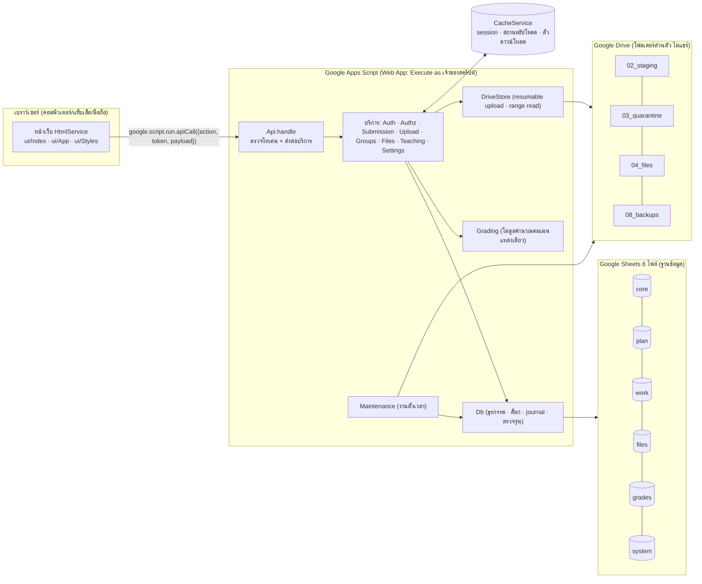

# สถาปัตยกรรมระบบ (Google Apps Script + Google Sheets + Google Drive)

เอกสารนี้อธิบายการออกแบบ **ระบบจัดเก็บข้อมูลและส่งงาน** ของ CWK Learning Hub ตาม Master Prompt
(`docs/requirements/master-prompt.md`) โดยใช้บริการของ Google เป็นฐานเริ่มต้น

## 1. ภาพรวม

| ส่วน | เทคโนโลยี | หน้าที่ |
| --- | --- | --- |
| หน้าเว็บ | HtmlService (HTML/CSS/JavaScript ล้วน) | ภาษาไทย รองรับมือถือ แสดงเวลา Asia/Bangkok ปี พ.ศ. ไม่ใช้สีอย่างเดียวสื่อสถานะ |
| บริการฝั่งเซิร์ฟเวอร์ | Google Apps Script (V8) | ตรวจสิทธิ์ทุกคำขอ ตรวจข้อมูล คำนวณ บันทึก |
| ฐานข้อมูล | Google Sheets 6 ไฟล์ 42 ตาราง | ข้อมูลเชิงสัมพันธ์ (id + foreign key ตรวจในโค้ด) ดู [02-data-model.md](02-data-model.md) |
| ที่เก็บไฟล์ | Google Drive (โฟลเดอร์ส่วนตัวของบัญชีระบบ) | ไฟล์งาน ไฟล์ที่ถูกกัก ชุดสำรอง ดู [03-file-storage.md](03-file-storage.md) |
| ข้อมูลชั่วคราว | CacheService | session, สถานะรอบอัปโหลด, ตั๋วดาวน์โหลด (หมดอายุเอง) |
| ความลับ | Script Properties | รหัสไฟล์ฐานข้อมูล/โฟลเดอร์, `PEPPER` สำหรับรหัสผ่าน |

## 2. เหตุผลที่เลือก และสิ่งที่ต้องยอมรับ

**ข้อดี**: ไม่มีค่าเซิร์ฟเวอร์ ใช้บัญชี Google ของโรงเรียนที่มีอยู่ ผู้ดูแลเปิดดูข้อมูลใน Sheets ได้เมื่อจำเป็น
ไฟล์อยู่ใน Drive ที่โรงเรียนควบคุม และสำรองด้วยการคัดลอกไฟล์ได้ง่าย

**ข้อจำกัด (ออกแบบรองรับไว้แล้วบางส่วน)**

| ข้อจำกัด | ผลกระทบ | วิธีรับมือในแบบนี้ |
| --- | --- | --- |
| Sheets ไม่มี transaction / foreign key | ข้อมูลอาจค้างครึ่งทาง | `Db.tx` ใช้ script lock + ตรวจทุกแถวก่อนเขียน + journal ภาพก่อนแก้ + ย้อนกลับ/กู้คืนอัตโนมัติ |
| ไม่มีการล็อกระดับแถว | สองคนแก้ทับกัน | คอลัมน์ `version` + `expectedVersion` → `CONFLICT` |
| เขียนได้ทีละธุรกรรม (script lock เดียว) | ช่วงนักเรียนส่งพร้อมกันมากต้องรอคิว | ทำงานหนัก (อัปโหลด ตรวจไฟล์) นอกล็อก; ในล็อกเขียนสั้นที่สุด; หน้าเว็บลองใหม่อัตโนมัติเมื่อได้ `BUSY` โดยใช้ idempotency key เดิม |
| 10 ล้านเซลล์ต่อไฟล์ Sheets | ข้อมูลหลายปีจะเต็ม | แยก 6 ไฟล์ตามกลุ่มข้อมูล; ต้องมีขั้นตอนย้ายข้อมูลปีเก่า (ระยะถัดไป) |
| Apps Script รันได้ครั้งละ ≤ 6 นาที, พร้อมกัน ≤ 30 execution | งานใหญ่ต้องแบ่งช่วง | อัปโหลด/ดาวน์โหลดทีละช่วง 2–3 MB; journal กู้คืนเมื่อถูกตัดกลางคัน |
| ไม่มีตัวสแกนไวรัส | ไฟล์อันตรายอาจหลุดผ่านการตรวจโครงสร้าง | ตรวจ magic bytes/โครงสร้าง ปฏิเสธไฟล์ปฏิบัติการ/มาโคร ไม่เปิดหรือรันไฟล์บนเซิร์ฟเวอร์ ไม่แชร์ไฟล์ (ระบุเป็นข้อจำกัดชัดเจน) |
| google.script.run ส่งข้อมูลไบนารีไม่ได้โดยตรง | อัปโหลด/ดาวน์โหลดต้องแปลง base64 | แบ่งช่วงและส่งต่อ Drive API แบบ resumable; ดาวน์โหลดด้วย Range request |
| ContentService ส่งไฟล์ไบนารีไม่ได้ | ไม่มี URL ดาวน์โหลดตรง | ใช้ตั๋วอายุ 10 นาทีผูกกับผู้ใช้ แล้วดึงเป็นช่วงผ่าน API |

## 3. การติดตั้งใช้งาน (deployment model)

- Web App ตั้ง **Execute as: Me (บัญชีระบบ)** — โค้ดเข้าถึง Sheets/Drive ด้วยสิทธิ์ของบัญชีระบบ ผู้ใช้ไม่ต้องมีสิทธิ์ในไฟล์ใด ๆ
- **Who has access: Anyone** (ค่าเริ่มต้น) เพราะนักเรียนอาจไม่มีบัญชี Google — การยืนยันตัวตนทำในระบบเอง
  หากทุกคนมีบัญชี Workspace ของโรงเรียน เปลี่ยนเป็น *Anyone within โดเมน* เพื่อเพิ่มอีกชั้นได้
- **บัญชีระบบ** ควรเป็นบัญชี Google Workspace for Education ของโรงเรียนที่สร้างเฉพาะ (เช่น `learninghub@โรงเรียน`)
  ไม่ใช่บัญชีส่วนตัวของครู เพื่อให้ข้อมูลอยู่กับโรงเรียนเมื่อบุคลากรเปลี่ยน และได้โควตา/พื้นที่ของ Workspace
- ฟังก์ชันระดับบนสุดทุกตัวเรียกจากเบราว์เซอร์ได้ผ่าน `google.script.run` ระบบจึงเปิดเฉพาะ `doGet`, `apiCall`, `include`
  ส่วน `setup`, `seedDemo`, `installTriggers`, `backupNow` ตรวจว่าเรียกโดยเจ้าของสคริปต์จาก editor เท่านั้น (`Guard.requireOwner`)
  และงานตั้งเวลาตรวจ `triggerUid` ของ trigger จริง

## 4. เส้นทางของคำขอ

1. หน้าเว็บเรียก `apiCall({ action, token, payload })`
2. `Api.handle` ล้างหน่วยความจำต่อคำขอ → ตรวจ action ที่รู้จัก → `Auth.authenticate(token)` สร้างบริบทผู้ใช้ (บทบาท ครู/นักเรียน โรงเรียน)
3. บริการตรวจสิทธิ์ตามบทบาท **และ** ความสัมพันธ์กับรายวิชา (`Authz`) ทุกครั้ง รวมการเปิดไฟล์
4. อ่านข้อมูลนอกล็อก ตรวจเงื่อนไข → `Db.tx` (ได้ล็อก → กู้คืน journal ค้างถ้ามี → อ่านสดใหม่ → ตรวจซ้ำ → เขียน → flush → ปล่อยล็อก)
5. งานหลังบันทึกสำเร็จ (`afterCommit`): บันทึกตรวจสอบ, แจ้งเตือน, ย้ายไฟล์บน Drive
6. ตอบ `{ ok: true, data }` หรือ `{ ok: false, error: { code, message, details } }` — ข้อผิดพลาดภายในแสดงเพียงรหัสอ้างอิง

## 5. โมดูล (ไฟล์ใน `gas/`)

| ไฟล์ | หน้าที่ |
| --- | --- |
| `Config.js` | ค่าคงที่ ค่าเริ่มต้นของโรงเรียน เพดานทางเทคนิค และ `Props` (อ่าน Script Properties ครั้งเดียวต่อคำขอ) |
| `Errors.js` | รหัสข้อผิดพลาดมาตรฐานและข้อความภาษาไทย |
| `Util.js` | เวลา (UTC ↔ ไทย/พ.ศ.) รหัส ไบต์ ตัวสุ่ม |
| `Crypto.js` | SHA-256 / HMAC / PBKDF2 แบบ JavaScript (ทดสอบเทียบ Node.js) |
| `Dec.js` | เลขทศนิยมแม่นยำ (เศษส่วน BigInt) |
| `Schema.js` | โครงสร้างตารางทั้งหมด (แหล่งความจริงเดียว สร้างเอกสารได้) |
| `Db.js` | ชั้นข้อมูลบน Sheets: อ่านแบบดัชนี ธุรกรรม ล็อก journal ตรวจรุ่น |
| `Setup.js` | ติดตั้ง/ปรับโครงสร้างแบบเพิ่มอย่างเดียว สร้างโรงเรียนและผู้ดูแล |
| `Settings.js` | ค่าตั้งระดับโรงเรียน + `Guard` ป้องกันฟังก์ชันผู้ดูแล |
| `Auth.js` / `Authz.js` | ยืนยันตัวตน / ตรวจสิทธิ์ |
| `Audit.js` | บันทึกตรวจสอบ (ตัดข้อมูลลับ) และแจ้งเตือนในระบบ |
| `FileCheck.js` | ตรวจชนิดไฟล์จริง โครงสร้าง ZIP/Office ชื่อไฟล์ |
| `DriveStore.js` | อัปโหลดแบบ resumable, อ่านช่วงไบต์, ย้าย/ทิ้งไฟล์ |
| `Upload.js` | begin / chunk / finalize เข้าฉบับร่าง |
| `Submission.js` | ส่งงาน รุ่น ใบยืนยัน สถานะ คิวตรวจ การตรวจรับ/ส่งคืน |
| `Groups.js` | จัดกลุ่ม snapshot ย้ายสมาชิก |
| `Files.js` | เปิด/ดาวน์โหลดไฟล์ และแฟ้มเสมือน |
| `Teaching.js` | รายวิชาที่สอน สร้าง/แก้ภาระงาน ขยายเวลา |
| `Grading.js` | คำนวณคะแนน (รายรายการ/รายหมวด ยกเว้น ปัดเศษ เกรด) และตรวจแผนคะแนน |
| `Maintenance.js` | ตรึงกลุ่มตามเวลา ล้างไฟล์ สำรอง คำนวณพื้นที่ |
| `Api.js` / `Main.js` | ตัวกลางคำขอ / ฟังก์ชันระดับบนสุด |
| `Seed.js` | ข้อมูลสาธิต (เฉพาะโปรเจกต์ที่ตั้ง `ENV=demo`) |
| `ui/*.html` | หน้าเว็บ |

## 6. ความพร้อมกันและความครบถ้วนของข้อมูล

- **ล็อก**: ทุกการเขียน (ยกเว้นตาราง lock-free) ผ่าน `LockService.getScriptLock()` รอได้ 25 วินาที ไม่ได้ → `BUSY`
- **ตรวจซ้ำภายใต้ล็อก**: เช่น จำนวนสมาชิกกลุ่มนับจากแถวจริงทุกครั้ง → สองคนกดเข้าที่ว่างสุดท้ายพร้อมกัน สำเร็จคนเดียว (A08)
- **ทั้งหมดหรือไม่มีเลย**: ธุรกรรมที่เขียนหลายช่วงบันทึก journal (ภาพก่อนแก้ของทุกแถว) ก่อนเขียน
  - เขียนล้มเหลว → คืนค่าทันที
  - execution ถูกตัด (หมดเวลา 6 นาที) → `TX_PENDING` ค้างใน Script Properties → ธุรกรรมถัดไปกู้คืนก่อนเริ่ม (A16)
- **ตรวจรุ่น**: แก้ภาระงาน/ตรวจงาน/อนุมัติกลุ่มส่ง `version` ที่เห็นมาด้วย ถ้าไม่ตรง → `CONFLICT` ไม่เขียนทับเงียบ ๆ
- **คำสั่งซ้ำ**: ส่งงานใช้ `idempotencyKey` ที่หน้าเว็บสร้างและเก็บไว้จนสำเร็จ กดซ้ำ/เน็ตหลุดแล้วส่งใหม่ได้ใบยืนยันเดิม (A22)
- **ส่งทับในกลุ่ม**: ส่งงานต้องแนบ `baseVersionNo` (รุ่นล่าสุดที่เห็น) ถ้ามีเพื่อนส่งก่อน → `CONFLICT` พร้อมชื่อผู้ส่งและเวลา
- **เวลา**: ใช้เวลาเซิร์ฟเวอร์เท่านั้นในการตัดสินส่งช้า/ปิดรับ

## 7. ความปลอดภัย

- รหัสผ่าน: PBKDF2-HMAC-SHA256 (60,000 รอบ ปรับได้) + salt ต่อบัญชี + pepper ใน Script Properties; ไม่เก็บรหัสจริง
- Session: โทเคนสุ่ม 256 บิต เก็บเฉพาะ HMAC ของโทเคนใน CacheService; หมดอายุเมื่อไม่ใช้งาน 120 นาที / สูงสุด 12 ชั่วโมง;
  เปลี่ยนรหัส/รีเซ็ต/ปิดบัญชี → เพิกถอนทุก session (`session_epoch`); บริบทผู้ใช้ (บทบาท ครู/นักเรียน) แคช 10 นาทีเพื่อลดการอ่านชีต
  และถูกล้างทันทีเมื่อบัญชีถูกแก้ผ่านระบบ (ไม่เก็บ hash รหัสผ่านในแคช)
- จำกัดการเดารหัส: ผิด 5 ครั้งล็อก 15 นาที (ปรับได้); ข้อความผิดพลาดไม่บอกว่าบัญชีมีอยู่หรือไม่
- ตรวจสิทธิ์ที่เซิร์ฟเวอร์ทุกคำขอ นักเรียนเดารหัสรายการ/แก้พารามิเตอร์ไม่เห็นของผู้อื่น (A13) ครูนอกรายวิชาถูกปฏิเสธ (A14)
- ไฟล์: ไม่แชร์ ไม่สร้างลิงก์สาธารณะ ดาวน์โหลดผ่านตั๋วอายุสั้นผูกผู้ใช้; แสดงตัวอย่างเฉพาะรูป/PDF, ข้อความแสดงผ่าน `textContent`
- หน้าเว็บ escape ข้อความทุกจุด ลิงก์ที่นักเรียนแนบต้องเป็น http/https เท่านั้น
- Sheets: ทุกค่าเป็นข้อความ ป้องกันสูตร (formula injection) ตั้งแต่ชั้นจัดเก็บ; ชีตตั้งการป้องกันแบบเตือนก่อนแก้
- บันทึกตรวจสอบตัดคีย์ที่มีคำว่า password/token/secret/url/ticket/hash ออกเสมอ
- **ข้อควรระวังของ Apps Script**: ผู้ที่เป็น editor ของโปรเจกต์หรือไฟล์ Sheets เห็นข้อมูลทั้งหมด จำกัดผู้แก้ไขให้น้อยที่สุด
  และเปิดการยืนยันตัวตนสองชั้นให้บัญชีระบบ

## 8. ความจุโดยประมาณ (ยังไม่ได้วัดจริงบน Apps Script)

สมมติฐาน: นักเรียน 1,000 คน รายวิชาที่เปิดสอน 100 กลุ่ม กลุ่มละ ~40 คน (ลงทะเบียน ~4,000) รายการประเมิน 20 รายการ/รายวิชา
(15 รายการส่งไฟล์) เฉลี่ย 1.3 รุ่นต่อการส่ง 2 ไฟล์ต่อรุ่น ไฟล์ละ ~1.5 MB ต่อปีการศึกษา

| ไฟล์ Sheets | แถวหลักต่อปี | เซลล์โดยประมาณต่อปี | หมายเหตุ |
| --- | --- | --- | --- |
| core | ~5,000 | < 0.2 ล้าน | |
| plan | ~2,000 | < 0.1 ล้าน | |
| work | submissions ~60,000, versions ~78,000 | ~3.2 ล้าน | |
| files | file_assets / submission_files ~156,000 | ~5.8 ล้าน | ใกล้เพดานใน ~1.5 ปี |
| grades | student_grades ~80,000, revisions ~160,000 | ~4.7 ล้าน | |
| system | audit_log ~400,000, notifications ~150,000 | ~6 ล้าน | ต้องย้าย log เก่าออกทุกปี |
| Drive | ~156,000 ไฟล์ | ~230 GB | **เกิน 15 GB ของบัญชีทั่วไป** ต้องใช้บัญชี Workspace for Education |

ข้อสรุป: แบบนี้เหมาะเป็น **ระบบเริ่มต้น/นำร่อง** (เช่น ไม่กี่ร้อยคน หรือบางกลุ่มสาระ) และใช้งานเต็มโรงเรียนได้ในปีแรก
หากมีขั้นตอนย้ายข้อมูลปีเก่า (ยังไม่ได้พัฒนา) ต้องทดสอบโหลดจริงตามข้อ 17 ก่อนใช้งานจริง

โควตา Apps Script ที่ต้องเฝ้าดู (ตามเอกสาร Google ควรตรวจค่าปัจจุบันอีกครั้ง): URL Fetch ต่อวัน (ทุกช่วงอัปโหลด/ดาวน์โหลดเป็นหนึ่งครั้ง),
เวลารวมของ trigger ต่อวัน, execution พร้อมกันสูงสุด 30, เวลาต่อ execution 6 นาที — บัญชี Workspace ได้โควตาสูงกว่าบัญชีทั่วไป

## 9. แนวทางย้ายไปฐานข้อมูลจริงเมื่อโตขึ้น

โค้ดแยกชั้นไว้เพื่อย้ายได้เป็นส่วน ๆ:
- `Schema.js` แปลงเป็น migration ของ PostgreSQL ได้ตรงตัว (ตาราง/คอลัมน์/unique/idx เดิม) และข้อมูลใน Sheets ส่งออกเป็น CSV ได้ทันที
- บริการ (`Submission`, `Groups`, `Grading` ฯลฯ) เรียกข้อมูลผ่าน `Db.get/find/tx` เท่านั้น → เปลี่ยน `Db` เป็นตัวเชื่อม JDBC (Cloud SQL) หรือ API ภายนอกได้
- `Grading.js`, `FileCheck.js`, `Crypto.js` เป็น JavaScript ล้วน ย้ายไป Node.js ได้โดยไม่แก้
- เกณฑ์ควรย้าย: ผู้ใช้พร้อมกันจนได้ `BUSY` บ่อย, เวลาตอบสนองเกิน ~5 วินาทีเป็นประจำ, หรือไฟล์ Sheets ใดเกิน ~7 ล้านเซลล์
