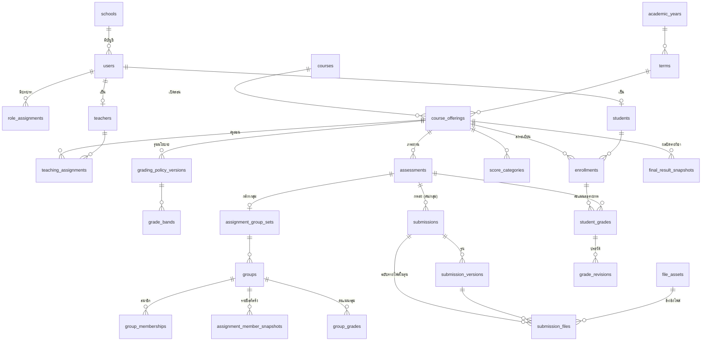

# แบบข้อมูล (Data Model) บน Google Sheets

> ไฟล์นี้สร้างอัตโนมัติจาก `gas/Schema.js` ด้วยคำสั่ง `npm run docs:schema` — แก้ที่ Schema.js แล้วสร้างใหม่ อย่าแก้ไฟล์นี้ด้วยมือ

## หลักการ

- **หนึ่งตาราง = หนึ่งชีต** แถวแรกเป็นชื่อคอลัมน์ ระบบอ่านตำแหน่งคอลัมน์จากหัวตาราง จึงเพิ่มคอลัมน์ใหม่ต่อท้ายได้ (ห้ามลบหรือสลับคอลัมน์)
- **แยกเป็น 6 ไฟล์ Google Sheets** ตามกลุ่มข้อมูล เพื่อไม่ชนเพดาน 10 ล้านเซลล์ต่อไฟล์ และสำรอง/กู้คืนเป็นส่วนได้
- **ทุกเซลล์เป็นข้อความ** (เขียนด้วย quote prefix `'`) รักษาเลขศูนย์นำหน้า เช่น `00123` ไม่ให้ Sheets แปลงวันที่/ตัวเลขเอง และข้อความที่ขึ้นต้นด้วย `= + - @` ไม่ถูกตีความเป็นสูตร
- **กุญแจหลักคือ `id` (UUID) ที่ไม่เปลี่ยน** ไม่ใช้ชื่อ ห้อง หรือรหัสนักเรียนเป็นตัวเชื่อม รหัสนักเรียนเป็นข้อมูลที่ตรวจไม่ซ้ำภายในโรงเรียน
- **ไม่ลบแถวจริง** ใช้สถานะหรือเวลาเพิกถอน (`revoked_at`, `status`) เพื่อเก็บหลักฐานย้อนหลัง (ยกเว้นตารางเทคนิค `tx_journal`)
- **`version`** เพิ่มทุกครั้งที่แก้แถว ใช้ตรวจการแก้ไขพร้อมกัน (optimistic locking) — ส่ง `expectedVersion` แล้วรุ่นไม่ตรงได้ `CONFLICT`
- **เวลา** เก็บเป็น ISO 8601 UTC แสดงผลเป็น Asia/Bangkok และปี พ.ศ.
- **คะแนน/น้ำหนัก** เก็บเป็นข้อความทศนิยม (`dec`) คำนวณด้วยเศษส่วนแม่นยำ ไม่ใช้ float
- **ค่าว่าง ≠ ศูนย์** คะแนนที่ยังไม่ประเมินเป็นค่าว่าง + สถานะ `not_assessed`

### คอลัมน์มาตรฐาน

| คอลัมน์ | ความหมาย |
| --- | --- |
| `id` | รหัสภายในที่ไม่เปลี่ยน (UUID) |
| `version` | เลขรุ่นของแถว เพิ่มทุกครั้งที่แก้ |
| `created_at`, `created_by` | เวลาเซิร์ฟเวอร์และผู้สร้าง |
| `updated_at`, `updated_by` | เวลาและผู้แก้ล่าสุด |

ตารางแบบ *append-only* (ประวัติ/บันทึก) มีเฉพาะ `id`, `created_at`, `created_by` และไม่แก้ไขหลังบันทึก

### ขนาดตารางและการค้นหา

- **small** — อ่านทั้งตารางครั้งเดียวต่อคำขอ (เช่น รายวิชา ครู การตั้งค่า)
- **large** — ค้นทีละคอลัมน์ที่มีดัชนีด้วย `TextFinder` แล้วอ่านเฉพาะแถวที่พบ (เช่น คะแนน การส่งงาน ไฟล์)
- **lock-free** — เพิ่มแถวด้วย `appendRow` ซึ่งเป็น atomic ไม่ต้องรอล็อก (บันทึกตรวจสอบ ประวัติ)

## แผนภาพความสัมพันธ์หลัก

## การจับคู่กับ Entity ในข้อกำหนด (ข้อ 15)

| กลุ่มข้อมูลในข้อกำหนด | ตารางในระบบ |
| --- | --- |
| School, User, RoleAssignment, Teacher, Student | `schools` `users` `role_assignments` `teachers` `students` (+ `settings`) |
| AcademicYear, Term, Course, CourseOffering, TeachingAssignment, Enrollment | `academic_years` `terms` `courses` `course_offerings` `teaching_assignments` `enrollments` (+ `enrollment_history`) |
| GradingPolicyVersion, GradeBand, ScoreCategory, Assessment, Rubric, RubricCriterion | `grading_policy_versions` `grade_bands` `score_categories` `assessments` `rubrics` `rubric_criteria` (+ `assessment_extensions`) |
| AssignmentGroupSet, Group, GroupMembershipHistory, AssignmentMemberSnapshot | `assignment_group_sets` `groups` `group_memberships` `group_membership_history` `assignment_member_snapshots` |
| Submission, SubmissionVersion, FileAsset, SubmissionFile | `submissions` `submission_versions` `file_assets` `submission_files` |
| GroupGrade, StudentGrade, GradeRevision, Feedback, GradePublication | `group_grades` `student_grades` `grade_revisions` `feedback` `grade_publications` |
| ImportJob, ImportRowResult, FinalResultSnapshot, ExportJob, Notification, AuditLog | `import_jobs` `import_row_results` `final_result_snapshots` `export_jobs` `notifications` `audit_log` (+ `idempotency_keys` `tx_journal`) |

## ไฟล์ `CWK_DB_core (บัญชี รายวิชา ทะเบียน)`

ตาราง: `schools` `settings` `users` `role_assignments` `teachers` `students` `academic_years` `terms` `courses` `course_offerings` `teaching_assignments` `enrollments` `enrollment_history`

### `schools`

โรงเรียน (ขอบเขตข้อมูลสูงสุด รองรับขยายหลายโรงเรียนภายหลัง)

- ประเภท: small
- ห้ามซ้ำ: (`code`)

| คอลัมน์ | ชนิด | จำเป็น | คำอธิบาย |
| --- | --- | --- | --- |
| `code` | รหัส (ข้อความ) | ✓ | รหัสโรงเรียน |
| `name_th` | ข้อความ | ✓ | ชื่อโรงเรียนภาษาไทย (แก้ได้ ไม่ฝังในโค้ด) |
| `name_en` | ข้อความ |  |  |
| `app_name` | ข้อความ |  | ชื่อระบบที่แสดง |
| `logo_file_id` | อ้างอิง → `file_assets` |  | ไฟล์ตราโรงเรียน |
| `primary_color` | ข้อความ |  |  |
| `contact_json` | JSON |  | ข้อมูลติดต่อ |
| `timezone` | ข้อความ |  |  (ค่าเริ่มต้น `Asia/Bangkok`) |
| `is_demo` | จริง/เท็จ |  | TRUE = ข้อมูลสมมติสำหรับสาธิต |
| `status` | ตัวเลือก: `active` `inactive` |  |  (ค่าเริ่มต้น `active`) |

### `settings`

ค่าตั้งระดับโรงเรียน (โควตา ชนิดไฟล์ อายุการเก็บ ฯลฯ)

- ประเภท: small
- ห้ามซ้ำ: (`school_id`, `key`)

| คอลัมน์ | ชนิด | จำเป็น | คำอธิบาย |
| --- | --- | --- | --- |
| `school_id` | อ้างอิง → `schools` | ✓ |  |
| `key` | ข้อความ | ✓ |  |
| `value_json` | JSON |  | ค่าเป็น JSON |
| `note` | ข้อความ |  |  |

### `users`

บัญชีผู้ใช้ (ไม่บังคับมีอีเมล ใช้รหัสนักเรียนเป็นชื่อผู้ใช้ได้)

- ประเภท: small
- ห้ามซ้ำ: (`school_id`, `username`)

| คอลัมน์ | ชนิด | จำเป็น | คำอธิบาย |
| --- | --- | --- | --- |
| `school_id` | อ้างอิง → `schools` | ✓ |  |
| `username` | รหัส (ข้อความ) | ✓ | ชื่อผู้ใช้ (ตัวพิมพ์เล็ก) เช่น รหัสนักเรียน |
| `display_name` | ข้อความ |  |  |
| `email` | ข้อความ |  | ไม่บังคับ (สำรองไว้เชื่อมบัญชี Google ของโรงเรียนในระยะถัดไป) |
| `password_hash` | ข้อความ |  | pbkdf2_sha256$รอบ$salt$hash (ห้ามเก็บรหัสผ่านจริง) **ข้อมูลลับ** |
| `must_change_password` | จริง/เท็จ |  |  |
| `status` | ตัวเลือก: `active` `disabled` |  |  (ค่าเริ่มต้น `active`) |
| `session_epoch` | จำนวนเต็ม |  | เพิ่มค่าเพื่อเพิกถอน session ทั้งหมดของผู้ใช้ (ค่าเริ่มต้น `0`) |
| `failed_login_count` | จำนวนเต็ม |  |  (ค่าเริ่มต้น `0`) |
| `locked_until` | วันเวลา ISO UTC |  |  |
| `password_updated_at` | วันเวลา ISO UTC |  |  |

### `role_assignments`

บทบาทของผู้ใช้ (หนึ่งคนมีได้หลายบทบาท) เพิกถอนโดยใส่ revoked_at ไม่ลบแถว

- ประเภท: small

| คอลัมน์ | ชนิด | จำเป็น | คำอธิบาย |
| --- | --- | --- | --- |
| `school_id` | อ้างอิง → `schools` | ✓ |  |
| `user_id` | อ้างอิง → `users` | ✓ |  |
| `role` | ตัวเลือก: `admin` `teacher` `student` `grade_admin` | ✓ | grade_admin = ผู้ดูแลที่มีสิทธิ์แก้คะแนน (ต้องมีบันทึก) |
| `revoked_at` | วันเวลา ISO UTC |  |  |
| `revoked_by` | อ้างอิง → `users` |  |  |
| `reason` | ข้อความ |  |  |

### `teachers`

ข้อมูลครู

- ประเภท: small
- ห้ามซ้ำ: (`school_id`, `teacher_code`)

| คอลัมน์ | ชนิด | จำเป็น | คำอธิบาย |
| --- | --- | --- | --- |
| `school_id` | อ้างอิง → `schools` | ✓ |  |
| `user_id` | อ้างอิง → `users` |  |  |
| `teacher_code` | รหัส (ข้อความ) | ✓ |  |
| `prefix` | ข้อความ |  |  |
| `first_name` | ข้อความ | ✓ |  |
| `last_name` | ข้อความ |  |  |
| `department` | ข้อความ |  | กลุ่มสาระ |
| `status` | ตัวเลือก: `active` `inactive` |  |  (ค่าเริ่มต้น `active`) |

### `students`

ทะเบียนนักเรียน (รหัสนักเรียนเก็บเป็นข้อความเสมอ เช่น 00123)

- ประเภท: small
- ห้ามซ้ำ: (`school_id`, `student_code`)

| คอลัมน์ | ชนิด | จำเป็น | คำอธิบาย |
| --- | --- | --- | --- |
| `school_id` | อ้างอิง → `schools` | ✓ |  |
| `user_id` | อ้างอิง → `users` |  |  |
| `student_code` | รหัส (ข้อความ) | ✓ | รหัสนักเรียน (ข้อความ รักษาศูนย์นำหน้า) |
| `prefix` | ข้อความ |  |  |
| `first_name` | ข้อความ | ✓ |  |
| `last_name` | ข้อความ |  |  |
| `class_level` | ข้อความ |  | ชั้น เช่น ม.5 |
| `room` | ข้อความ |  | ห้อง เช่น 1 |
| `roll_no` | จำนวนเต็ม |  | เลขที่ |
| `status` | ตัวเลือก: `active` `graduated` `transferred` `withdrawn` `inactive` |  |  (ค่าเริ่มต้น `active`) |

### `academic_years`

ปีการศึกษา (พ.ศ.)

- ประเภท: small
- ห้ามซ้ำ: (`school_id`, `year_be`)

| คอลัมน์ | ชนิด | จำเป็น | คำอธิบาย |
| --- | --- | --- | --- |
| `school_id` | อ้างอิง → `schools` | ✓ |  |
| `year_be` | จำนวนเต็ม | ✓ | ปีการศึกษา พ.ศ. เช่น 2569 |
| `start_date` | วันที่ YYYY-MM-DD |  |  |
| `end_date` | วันที่ YYYY-MM-DD |  |  |
| `status` | ตัวเลือก: `planning` `active` `closed` |  |  (ค่าเริ่มต้น `active`) |

### `terms`

ภาคเรียน

- ประเภท: small
- ห้ามซ้ำ: (`academic_year_id`, `term_no`)

| คอลัมน์ | ชนิด | จำเป็น | คำอธิบาย |
| --- | --- | --- | --- |
| `school_id` | อ้างอิง → `schools` | ✓ |  |
| `academic_year_id` | อ้างอิง → `academic_years` | ✓ |  |
| `term_no` | จำนวนเต็ม | ✓ | 1, 2 หรือ 3 (ภาคฤดูร้อน) |
| `name` | ข้อความ |  |  |
| `start_date` | วันที่ YYYY-MM-DD |  |  |
| `end_date` | วันที่ YYYY-MM-DD |  |  |
| `status` | ตัวเลือก: `planning` `active` `closed` |  |  (ค่าเริ่มต้น `active`) |

### `courses`

รายวิชาในหลักสูตร (ไม่ผูกปี/ภาค)

- ประเภท: small
- ห้ามซ้ำ: (`school_id`, `course_code`)

| คอลัมน์ | ชนิด | จำเป็น | คำอธิบาย |
| --- | --- | --- | --- |
| `school_id` | อ้างอิง → `schools` | ✓ |  |
| `course_code` | รหัส (ข้อความ) | ✓ | รหัสวิชา เช่น ว32201 |
| `name_th` | ข้อความ | ✓ |  |
| `name_en` | ข้อความ |  |  |
| `learning_area` | ข้อความ |  | กลุ่มสาระการเรียนรู้ |
| `grade_level` | ข้อความ |  |  |
| `description` | ข้อความ |  |  |
| `credits` | ทศนิยม (ข้อความ) |  | หน่วยกิต |
| `hours` | จำนวนเต็ม |  | ชั่วโมงเรียน |
| `status` | ตัวเลือก: `active` `inactive` |  |  (ค่าเริ่มต้น `active`) |

### `course_offerings`

รายวิชาที่เปิดสอน = วิชา + ปี + ภาค + กลุ่มเรียน (คะแนนไม่ข้ามภาคหรือปนห้อง)

- ประเภท: small
- ห้ามซ้ำ: (`term_id`, `course_id`, `section_code`)

| คอลัมน์ | ชนิด | จำเป็น | คำอธิบาย |
| --- | --- | --- | --- |
| `school_id` | อ้างอิง → `schools` | ✓ |  |
| `course_id` | อ้างอิง → `courses` | ✓ |  |
| `term_id` | อ้างอิง → `terms` | ✓ |  |
| `section_code` | รหัส (ข้อความ) | ✓ | กลุ่มเรียน เช่น ม.5/1 |
| `display_name` | ข้อความ |  |  |
| `owner_teacher_id` | อ้างอิง → `teachers` | ✓ | ครูเจ้าของรายวิชา |
| `status` | ตัวเลือก: `draft` `open` `closed` `archived` |  |  (ค่าเริ่มต้น `draft`) |
| `calc_method` | ตัวเลือก: `per_item` `per_category` |  | วิธีคำนวณ: น้ำหนักรายรายการ / รายหมวด (ค่าเริ่มต้น `per_item`) |
| `active_policy_version_id` | อ้างอิง → `grading_policy_versions` |  |  |
| `copied_from_offering_id` | อ้างอิง → `course_offerings` |  |  |
| `drive_folder_id` | ข้อความ |  | โฟลเดอร์ไฟล์จริงบน Drive (สร้างอัตโนมัติ) |
| `quota_mb` | จำนวนเต็ม |  | โควตาไฟล์ของรายวิชา (0 = ใช้ของโรงเรียน) |
| `closed_at` | วันเวลา ISO UTC |  |  |
| `closed_by` | อ้างอิง → `users` |  |  |

### `teaching_assignments`

ครูที่สอนรายวิชาที่เปิดสอน พร้อมสิทธิ์แยกรายการ

- ประเภท: small

| คอลัมน์ | ชนิด | จำเป็น | คำอธิบาย |
| --- | --- | --- | --- |
| `school_id` | อ้างอิง → `schools` | ✓ |  |
| `offering_id` | อ้างอิง → `course_offerings` | ✓ |  |
| `teacher_id` | อ้างอิง → `teachers` | ✓ |  |
| `role` | ตัวเลือก: `owner` `co_teacher` | ✓ |  |
| `can_view` | จริง/เท็จ |  | ดูข้อมูลรายวิชาและงาน |
| `can_grade` | จริง/เท็จ |  | ตรวจงาน/ให้คะแนน |
| `can_edit_scores` | จริง/เท็จ |  | แก้คะแนนที่บันทึกแล้ว |
| `can_import` | จริง/เท็จ |  | นำเข้าข้อมูล/คะแนน |
| `can_export` | จริง/เท็จ |  | ส่งออกรายงาน |
| `can_publish` | จริง/เท็จ |  | ประกาศ/เรียกคืนคะแนน |
| `can_close` | จริง/เท็จ |  | ปิดผลรายวิชา |
| `can_manage` | จริง/เท็จ |  | จัดการงาน กลุ่ม และนักเรียนในรายวิชา |
| `revoked_at` | วันเวลา ISO UTC |  |  |
| `revoked_by` | อ้างอิง → `users` |  |  |

### `enrollments`

การลงทะเบียนเรียน (นักเรียน × รายวิชาที่เปิดสอน) พร้อมวันมีผล

- ประเภท: large
- ดัชนีค้นหา: `offering_id`, `student_id`
- ห้ามซ้ำ: (`offering_id`, `student_id`)

| คอลัมน์ | ชนิด | จำเป็น | คำอธิบาย |
| --- | --- | --- | --- |
| `school_id` | อ้างอิง → `schools` | ✓ |  |
| `offering_id` | อ้างอิง → `course_offerings` | ✓ |  |
| `student_id` | อ้างอิง → `students` | ✓ |  |
| `status` | ตัวเลือก: `active` `withdrawn` `transferred_out` `completed` |  |  (ค่าเริ่มต้น `active`) |
| `effective_from` | วันเวลา ISO UTC |  | วันเวลามีผลของการลงทะเบียน |
| `effective_to` | วันเวลา ISO UTC |  | วันเวลาสิ้นสุด (ถอน/ย้าย/จบ) |
| `source` | ข้อความ |  | manual หรือ import:<import_job_id> |
| `reason` | ข้อความ |  |  |

### `enrollment_history`

ประวัติการเพิ่ม ย้าย ถอน จบ ของการลงทะเบียน

- ประเภท: large, append-only, lock-free
- ดัชนีค้นหา: `enrollment_id`

| คอลัมน์ | ชนิด | จำเป็น | คำอธิบาย |
| --- | --- | --- | --- |
| `enrollment_id` | อ้างอิง → `enrollments` | ✓ |  |
| `action` | ตัวเลือก: `enroll` `withdraw` `transfer_out` `complete` `reactivate` | ✓ |  |
| `from_status` | ข้อความ |  |  |
| `to_status` | ข้อความ |  |  |
| `effective_at` | วันเวลา ISO UTC |  |  |
| `reason` | ข้อความ |  |  |

## ไฟล์ `CWK_DB_plan (แผนคะแนนและภาระงาน)`

ตาราง: `grading_policy_versions` `grade_bands` `score_categories` `assessments` `rubrics` `rubric_criteria` `assessment_extensions`

### `grading_policy_versions`

รุ่นนโยบายคะแนนของรายวิชา (เปลี่ยนหลังเริ่มให้คะแนน = สร้างรุ่นใหม่)

- ประเภท: small
- ห้ามซ้ำ: (`offering_id`, `version_no`)

| คอลัมน์ | ชนิด | จำเป็น | คำอธิบาย |
| --- | --- | --- | --- |
| `offering_id` | อ้างอิง → `course_offerings` | ✓ |  |
| `version_no` | จำนวนเต็ม | ✓ |  |
| `calc_method` | ตัวเลือก: `per_item` `per_category` | ✓ |  |
| `rounding_digits` | จำนวนเต็ม |  |  (ค่าเริ่มต้น `2`) |
| `rounding_mode` | ตัวเลือก: `half_up` |  | ปัดครั้งเดียวตอนสรุป (ค่าเริ่มต้น `half_up`) |
| `pass_threshold` | ทศนิยม (ข้อความ) |  | เกณฑ์ผ่าน (ร้อยละ) |
| `late_penalty_json` | JSON |  | กฎหักคะแนนส่งช้า (ปิดเป็นค่าเริ่มต้น) |
| `special_status_json` | JSON |  | สถานะพิเศษ เช่น ร มส มผ ที่โรงเรียนกำหนด |
| `retake_rule` | ตัวเลือก: `none` `latest` `highest` `cap` |  |  (ค่าเริ่มต้น `none`) |
| `status` | ตัวเลือก: `draft` `active` `superseded` |  |  (ค่าเริ่มต้น `draft`) |
| `change_reason` | ข้อความ |  |  |
| `activated_at` | วันเวลา ISO UTC |  |  |
| `activated_by` | อ้างอิง → `users` |  |  |

### `grade_bands`

ช่วงเกรดของรุ่นนโยบาย (min รวม, max ไม่รวม ยกเว้นช่วงบนสุด)

- ประเภท: small

| คอลัมน์ | ชนิด | จำเป็น | คำอธิบาย |
| --- | --- | --- | --- |
| `policy_version_id` | อ้างอิง → `grading_policy_versions` | ✓ |  |
| `min_score` | ทศนิยม (ข้อความ) | ✓ |  |
| `max_score` | ทศนิยม (ข้อความ) | ✓ |  |
| `grade_label` | ข้อความ | ✓ |  |
| `grade_point` | ทศนิยม (ข้อความ) |  |  |
| `sort` | จำนวนเต็ม |  |  |

### `score_categories`

หมวดคะแนนที่ครูสร้างเอง

- ประเภท: small

| คอลัมน์ | ชนิด | จำเป็น | คำอธิบาย |
| --- | --- | --- | --- |
| `offering_id` | อ้างอิง → `course_offerings` | ✓ |  |
| `policy_version_id` | อ้างอิง → `grading_policy_versions` | ✓ |  |
| `name` | ข้อความ | ✓ |  |
| `weight` | ทศนิยม (ข้อความ) |  | น้ำหนักหมวด (วิธีรายหมวด หมวดรวม 100) |
| `inner_weight_mode` | ตัวเลือก: `equal` `by_max` `custom` |  |  (ค่าเริ่มต้น `equal`) |
| `sort` | จำนวนเต็ม |  |  |

### `assessments`

รายการประเมิน/ภาระงาน (งานเดี่ยว งานกลุ่ม สอบ หรือรับคะแนนอย่างเดียว)

- ประเภท: small
- ห้ามซ้ำ: (`offering_id`, `code`)

| คอลัมน์ | ชนิด | จำเป็น | คำอธิบาย |
| --- | --- | --- | --- |
| `offering_id` | อ้างอิง → `course_offerings` | ✓ |  |
| `category_id` | อ้างอิง → `score_categories` |  |  |
| `code` | รหัส (ข้อความ) | ✓ | รหัสรายการ ใช้จับคู่ตอนนำเข้าคะแนน |
| `title` | ข้อความ | ✓ |  |
| `description` | ข้อความ |  |  |
| `kind` | ตัวเลือก: `individual` `group` `exam` `score_only` | ✓ |  |
| `submission_mode` | ตัวเลือก: `none` `file` `file_or_link` |  |  (ค่าเริ่มต้น `file`) |
| `max_score` | ทศนิยม (ข้อความ) | ✓ | คะแนนเต็ม |
| `weight` | ทศนิยม (ข้อความ) |  | น้ำหนักในรายวิชา (วิธีรายรายการ) |
| `inner_weight` | ทศนิยม (ข้อความ) |  | น้ำหนักภายในหมวด (โหมด custom) |
| `counts_toward_grade` | จริง/เท็จ |  |  (ค่าเริ่มต้น `true`) |
| `open_at` | วันเวลา ISO UTC |  | เปิดรับ |
| `due_at` | วันเวลา ISO UTC |  | กำหนดส่ง |
| `close_at` | วันเวลา ISO UTC |  | ปิดรับ (หลังกำหนดส่งได้ถ้าอนุญาตส่งช้า) |
| `allow_late` | จริง/เท็จ |  |  (ค่าเริ่มต้น `false`) |
| `allowed_types` | ข้อความ |  | ชุดย่อยชนิดไฟล์ เช่น pdf,jpg,png (ว่าง = ตามโรงเรียน) |
| `max_files` | จำนวนเต็ม |  | จำนวนไฟล์ต่อการส่ง (ไม่เกินเพดานโรงเรียน) |
| `max_file_mb` | จำนวนเต็ม |  | ขนาดต่อไฟล์ MB (ไม่เกินเพดานโรงเรียน) |
| `max_attempts` | จำนวนเต็ม |  | 0 = ไม่จำกัดจำนวนครั้ง (ค่าเริ่มต้น `0`) |
| `allow_links` | จริง/เท็จ |  |  (ค่าเริ่มต้น `false`) |
| `group_submit_policy` | ตัวเลือก: `any_member` `leader_only` |  |  (ค่าเริ่มต้น `any_member`) |
| `attachments_json` | JSON |  | ไฟล์แนบของครู (file_asset_id) |
| `status` | ตัวเลือก: `draft` `published` `archived` |  |  (ค่าเริ่มต้น `draft`) |
| `sort` | จำนวนเต็ม |  |  |

### `rubrics`

รูบริกของรายการประเมิน

- ประเภท: small

| คอลัมน์ | ชนิด | จำเป็น | คำอธิบาย |
| --- | --- | --- | --- |
| `assessment_id` | อ้างอิง → `assessments` | ✓ |  |
| `title` | ข้อความ |  |  |

### `rubric_criteria`

เกณฑ์ย่อยของรูบริก

- ประเภท: small

| คอลัมน์ | ชนิด | จำเป็น | คำอธิบาย |
| --- | --- | --- | --- |
| `rubric_id` | อ้างอิง → `rubrics` | ✓ |  |
| `title` | ข้อความ | ✓ |  |
| `description` | ข้อความ |  |  |
| `max_points` | ทศนิยม (ข้อความ) | ✓ |  |
| `sort` | จำนวนเต็ม |  |  |

### `assessment_extensions`

การขยายเวลารายบุคคลหรือรายกลุ่ม

- ประเภท: small

| คอลัมน์ | ชนิด | จำเป็น | คำอธิบาย |
| --- | --- | --- | --- |
| `assessment_id` | อ้างอิง → `assessments` | ✓ |  |
| `target_type` | ตัวเลือก: `student` `group` | ✓ |  |
| `target_id` | อ้างอิง | ✓ | students.id หรือ groups.id |
| `due_at` | วันเวลา ISO UTC |  |  |
| `close_at` | วันเวลา ISO UTC |  |  |
| `reason` | ข้อความ |  |  |
| `revoked_at` | วันเวลา ISO UTC |  |  |

## ไฟล์ `CWK_DB_work (กลุ่ม การส่งงาน)`

ตาราง: `assignment_group_sets` `groups` `group_memberships` `group_membership_history` `assignment_member_snapshots` `submissions` `submission_versions`

### `assignment_group_sets`

กติกาการจัดกลุ่มของงานกลุ่ม (กลุ่มแยกตามงานเป็นค่าเริ่มต้น)

- ประเภท: small
- ห้ามซ้ำ: (`assessment_id`)

| คอลัมน์ | ชนิด | จำเป็น | คำอธิบาย |
| --- | --- | --- | --- |
| `offering_id` | อ้างอิง → `course_offerings` | ✓ |  |
| `assessment_id` | อ้างอิง → `assessments` | ✓ |  |
| `min_size` | จำนวนเต็ม | ✓ |  |
| `max_size` | จำนวนเต็ม | ✓ |  |
| `formation_close_at` | วันเวลา ISO UTC |  | วันปิดจัดกลุ่ม (ตรึงรายชื่ออัตโนมัติ) |
| `require_approval` | จริง/เท็จ |  |  (ค่าเริ่มต้น `false`) |
| `section_restricted` | จริง/เท็จ |  | สมาชิกต้องอยู่กลุ่มเรียนเดียวกัน (ค่าเริ่มต้น `true`) |
| `copied_from_set_id` | อ้างอิง → `assignment_group_sets` |  |  |
| `all_frozen_at` | วันเวลา ISO UTC |  | เวลาที่ตรึงทุกกลุ่มเมื่อถึงวันปิดจัดกลุ่ม |

### `groups`

กลุ่มของงาน

- ประเภท: large
- ดัชนีค้นหา: `group_set_id`, `assessment_id`

| คอลัมน์ | ชนิด | จำเป็น | คำอธิบาย |
| --- | --- | --- | --- |
| `group_set_id` | อ้างอิง → `assignment_group_sets` | ✓ |  |
| `assessment_id` | อ้างอิง → `assessments` | ✓ |  |
| `offering_id` | อ้างอิง → `course_offerings` | ✓ |  |
| `name` | ข้อความ | ✓ |  |
| `leader_student_id` | อ้างอิง → `students` |  |  |
| `status` | ตัวเลือก: `forming` `pending_approval` `approved` `frozen` `disbanded` |  |  (ค่าเริ่มต้น `forming`) |
| `active_count` | จำนวนเต็ม |  | จำนวนสมาชิกปัจจุบัน (ตรวจภายใต้ล็อก) (ค่าเริ่มต้น `0`) |
| `size_exception` | จริง/เท็จ |  | ครูอนุมัติข้อยกเว้นจำนวนสมาชิก (ค่าเริ่มต้น `false`) |
| `size_exception_reason` | ข้อความ |  |  |
| `frozen_at` | วันเวลา ISO UTC |  |  |
| `frozen_reason` | ตัวเลือก: `first_submission` `formation_closed` `teacher` |  |  |
| `snapshot_no` | จำนวนเต็ม |  | รุ่น snapshot สมาชิกปัจจุบัน (ค่าเริ่มต้น `0`) |

### `group_memberships`

สมาชิกกลุ่มปัจจุบันและคำเชิญ (หนึ่งคน active ได้หนึ่งกลุ่มต่องาน)

- ประเภท: large
- ดัชนีค้นหา: `group_set_id`, `group_id`, `student_id`

| คอลัมน์ | ชนิด | จำเป็น | คำอธิบาย |
| --- | --- | --- | --- |
| `group_set_id` | อ้างอิง → `assignment_group_sets` | ✓ |  |
| `group_id` | อ้างอิง → `groups` | ✓ |  |
| `student_id` | อ้างอิง → `students` | ✓ |  |
| `status` | ตัวเลือก: `invited` `requested` `active` `declined` `left` `removed` `cancelled` | ✓ |  |
| `invited_by_user_id` | อ้างอิง → `users` |  |  |
| `responded_at` | วันเวลา ISO UTC |  |  |

### `group_membership_history`

ประวัติการเปลี่ยนสมาชิกกลุ่ม

- ประเภท: large, append-only, lock-free
- ดัชนีค้นหา: `group_id`

| คอลัมน์ | ชนิด | จำเป็น | คำอธิบาย |
| --- | --- | --- | --- |
| `group_set_id` | อ้างอิง → `assignment_group_sets` |  |  |
| `group_id` | อ้างอิง → `groups` | ✓ |  |
| `student_id` | อ้างอิง → `students` |  |  |
| `action` | ข้อความ | ✓ | create invite accept decline request approve leave remove move_in move_out freeze approve_group |
| `reason` | ข้อความ |  |  |
| `detail_json` | JSON |  |  |

### `assignment_member_snapshots`

รายชื่อสมาชิกที่ตรึงของงานกลุ่ม (snapshot) ใช้กระจายคะแนนและสิทธิ์ดูไฟล์

- ประเภท: large
- ดัชนีค้นหา: `assessment_id`, `group_id`

| คอลัมน์ | ชนิด | จำเป็น | คำอธิบาย |
| --- | --- | --- | --- |
| `assessment_id` | อ้างอิง → `assessments` | ✓ |  |
| `group_id` | อ้างอิง → `groups` | ✓ |  |
| `snapshot_no` | จำนวนเต็ม | ✓ |  |
| `student_id` | อ้างอิง → `students` | ✓ |  |
| `enrollment_id` | อ้างอิง → `enrollments` |  |  |
| `trigger` | ตัวเลือก: `first_submission` `formation_closed` `teacher` | ✓ |  |
| `is_current` | จริง/เท็จ |  |  (ค่าเริ่มต้น `true`) |
| `reason` | ข้อความ |  |  |

### `submissions`

การส่งงาน (หนึ่งแถวต่อ งาน × เจ้าของ ซึ่งเป็นนักเรียนหรือกลุ่ม)

- ประเภท: large
- ดัชนีค้นหา: `assessment_id`, `owner_id`
- ห้ามซ้ำ: (`assessment_id`, `owner_type`, `owner_id`)

| คอลัมน์ | ชนิด | จำเป็น | คำอธิบาย |
| --- | --- | --- | --- |
| `assessment_id` | อ้างอิง → `assessments` | ✓ |  |
| `offering_id` | อ้างอิง → `course_offerings` | ✓ |  |
| `owner_type` | ตัวเลือก: `student` `group` | ✓ |  |
| `owner_id` | อ้างอิง | ✓ | students.id หรือ groups.id |
| `status` | ตัวเลือก: `draft` `submitted` `resubmitted` `returned` `accepted` |  | สถานะการส่ง/ตรวจ (สถานะคะแนนแยกไว้ที่ student_grades) (ค่าเริ่มต้น `draft`) |
| `current_version_no` | จำนวนเต็ม |  |  (ค่าเริ่มต้น `0`) |
| `latest_version_id` | อ้างอิง → `submission_versions` |  |  |
| `accepted_version_id` | อ้างอิง → `submission_versions` |  | รุ่นที่ครูเลือกรับประเมิน |
| `first_submitted_at` | วันเวลา ISO UTC |  |  |
| `last_submitted_at` | วันเวลา ISO UTC |  |  |

### `submission_versions`

รุ่นการส่ง (ส่งซ้ำ = รุ่นใหม่ รุ่นเดิมไม่ถูกลบ)

- ประเภท: large
- ดัชนีค้นหา: `submission_id`, `assessment_id`, `receipt_code`
- ห้ามซ้ำ: (`submission_id`, `version_no`) (`receipt_code`)

| คอลัมน์ | ชนิด | จำเป็น | คำอธิบาย |
| --- | --- | --- | --- |
| `submission_id` | อ้างอิง → `submissions` | ✓ |  |
| `assessment_id` | อ้างอิง → `assessments` | ✓ |  |
| `version_no` | จำนวนเต็ม | ✓ |  |
| `submitted_by_user_id` | อ้างอิง → `users` | ✓ |  |
| `submitted_by_student_id` | อ้างอิง → `students` |  |  |
| `submitted_at` | วันเวลา ISO UTC | ✓ | เวลาเซิร์ฟเวอร์ |
| `due_at_effective` | วันเวลา ISO UTC |  | กำหนดส่งที่ใช้ (รวมการขยายเวลา) |
| `is_late` | จริง/เท็จ |  |  |
| `late_seconds` | จำนวนเต็ม |  |  |
| `comment` | ข้อความ |  |  |
| `links_json` | JSON |  |  |
| `file_count` | จำนวนเต็ม |  |  |
| `total_bytes` | จำนวนเต็ม |  |  |
| `receipt_code` | รหัส (ข้อความ) | ✓ | รหัสใบยืนยันการส่ง |
| `member_snapshot_no` | จำนวนเต็ม |  | snapshot สมาชิกกลุ่ม ณ เวลาส่ง |
| `review_status` | ตัวเลือก: `pending` `returned` `accepted` `superseded` |  |  (ค่าเริ่มต้น `pending`) |
| `review_note` | ข้อความ |  |  |
| `reviewed_by` | อ้างอิง → `users` |  |  |
| `reviewed_at` | วันเวลา ISO UTC |  |  |

## ไฟล์ `CWK_DB_files (metadata ไฟล์และการอ้างอิงไฟล์)`

ตาราง: `submission_files` `file_assets`

### `submission_files`

ไฟล์ในฉบับร่างหรือในรุ่นที่ส่ง (อ้างอิง file_assets ไม่คัดลอกไฟล์ซ้ำ)

- ประเภท: large
- ดัชนีค้นหา: `submission_id`, `submission_version_id`, `file_asset_id`

| คอลัมน์ | ชนิด | จำเป็น | คำอธิบาย |
| --- | --- | --- | --- |
| `submission_id` | อ้างอิง → `submissions` | ✓ |  |
| `submission_version_id` | อ้างอิง → `submission_versions` |  | ว่าง = อยู่ในฉบับร่าง |
| `file_asset_id` | อ้างอิง → `file_assets` | ✓ |  |
| `added_by_user_id` | อ้างอิง → `users` |  |  |
| `state` | ตัวเลือก: `draft` `submitted` `removed` | ✓ |  |
| `sort` | จำนวนเต็ม |  |  |

### `file_assets`

metadata ของไฟล์ทุกไฟล์ (ไฟล์จริงอยู่ใน Google Drive โฟลเดอร์ส่วนตัวของระบบ)

- ประเภท: large
- ดัชนีค้นหา: `drive_file_id`, `state`

| คอลัมน์ | ชนิด | จำเป็น | คำอธิบาย |
| --- | --- | --- | --- |
| `school_id` | อ้างอิง → `schools` | ✓ |  |
| `drive_file_id` | ข้อความ |  | รหัสไฟล์บน Drive (ตัวเชื่อมถาวร ไม่ขึ้นกับชื่อ/โฟลเดอร์) |
| `storage_name` | ข้อความ |  | ชื่อไฟล์จริงที่เก็บ = <id>.<ext> (แยกจากชื่อที่นักเรียนตั้ง) |
| `original_name` | ข้อความ |  | ชื่อเดิมจากผู้อัปโหลด (ผ่านการกรองอักขระ) |
| `extension` | ข้อความ |  |  |
| `declared_mime` | ข้อความ |  | Content-Type จากเบราว์เซอร์ (ไม่เชื่อถือ) |
| `detected_type` | ข้อความ |  | ชนิดจริงจากการตรวจ magic bytes/โครงสร้างไฟล์ |
| `size_bytes` | จำนวนเต็ม |  |  |
| `sha256` | ข้อความ |  |  |
| `md5` | ข้อความ |  |  |
| `uploaded_by_user_id` | อ้างอิง → `users` |  |  |
| `purpose` | ตัวเลือก: `submission` `feedback` `attachment` `import` `export` `logo` `snapshot` | ✓ |  |
| `offering_id` | อ้างอิง → `course_offerings` |  |  |
| `assessment_id` | อ้างอิง → `assessments` |  |  |
| `state` | ตัวเลือก: `staging` `stored` `quarantined` `trashed` `purged` | ✓ |  |
| `check_status` | ตัวเลือก: `pending` `passed` `rejected` |  |  (ค่าเริ่มต้น `pending`) |
| `check_detail` | ข้อความ |  |  |
| `retention_until` | วันเวลา ISO UTC |  |  |
| `trashed_at` | วันเวลา ISO UTC |  |  |

## ไฟล์ `CWK_DB_grades (คะแนนและการประกาศผล)`

ตาราง: `student_grades` `group_grades` `grade_revisions` `feedback` `grade_publications` `final_result_snapshots`

### `student_grades`

คะแนนปัจจุบันหนึ่งผลต่อ (การลงทะเบียน × รายการประเมิน) ประวัติอยู่ที่ grade_revisions

- ประเภท: large
- ดัชนีค้นหา: `offering_id`, `assessment_id`, `student_id`
- ห้ามซ้ำ: (`enrollment_id`, `assessment_id`)

| คอลัมน์ | ชนิด | จำเป็น | คำอธิบาย |
| --- | --- | --- | --- |
| `offering_id` | อ้างอิง → `course_offerings` | ✓ |  |
| `assessment_id` | อ้างอิง → `assessments` | ✓ |  |
| `enrollment_id` | อ้างอิง → `enrollments` | ✓ |  |
| `student_id` | อ้างอิง → `students` | ✓ |  |
| `status` | ตัวเลือก: `not_assessed` `scored` `missing` `excused` `needs_revision` |  |  (ค่าเริ่มต้น `not_assessed`) |
| `raw_score` | ทศนิยม (ข้อความ) |  | คะแนนดิบ 0..คะแนนเต็ม (ว่าง ≠ ศูนย์) |
| `late_penalty` | ทศนิยม (ข้อความ) |  |  |
| `final_score` | ทศนิยม (ข้อความ) |  | คะแนนหลังหักส่งช้า (ถ้ามี) |
| `source` | ตัวเลือก: `teacher` `group` `import` `rubric` |  |  |
| `source_ref` | ข้อความ |  |  |
| `group_grade_id` | อ้างอิง → `group_grades` |  |  |
| `is_override` | จริง/เท็จ |  | ครูปรับคะแนนรายคนจากคะแนนกลุ่ม |
| `override_reason` | ข้อความ |  |  |
| `excuse_reason` | ข้อความ |  |  |
| `graded_version_id` | อ้างอิง → `submission_versions` |  |  |
| `publication` | ตัวเลือก: `draft` `published` |  |  (ค่าเริ่มต้น `draft`) |
| `published_status` | ข้อความ |  | สถานะที่นักเรียนเห็น (ค่าที่ประกาศล่าสุด) |
| `published_score` | ทศนิยม (ข้อความ) |  | คะแนนที่นักเรียนเห็น (ค่าที่ประกาศล่าสุด) |
| `published_at` | วันเวลา ISO UTC |  |  |

### `group_grades`

คะแนนกลุ่มตั้งต้น (ไม่หารจำนวนสมาชิก)

- ประเภท: large
- ดัชนีค้นหา: `assessment_id`, `group_id`
- ห้ามซ้ำ: (`assessment_id`, `group_id`)

| คอลัมน์ | ชนิด | จำเป็น | คำอธิบาย |
| --- | --- | --- | --- |
| `assessment_id` | อ้างอิง → `assessments` | ✓ |  |
| `group_id` | อ้างอิง → `groups` | ✓ |  |
| `snapshot_no` | จำนวนเต็ม |  |  |
| `submission_version_id` | อ้างอิง → `submission_versions` |  |  |
| `raw_score` | ทศนิยม (ข้อความ) |  |  |
| `status` | ตัวเลือก: `not_assessed` `scored` `missing` `excused` `needs_revision` |  |  (ค่าเริ่มต้น `not_assessed`) |
| `note` | ข้อความ |  |  |

### `grade_revisions`

ประวัติการเปลี่ยนคะแนนทุกครั้ง (ค่าก่อน/หลัง ที่มา เหตุผล ผู้แก้)

- ประเภท: large, append-only
- ดัชนีค้นหา: `student_grade_id`

| คอลัมน์ | ชนิด | จำเป็น | คำอธิบาย |
| --- | --- | --- | --- |
| `student_grade_id` | อ้างอิง → `student_grades` | ✓ |  |
| `revision_no` | จำนวนเต็ม | ✓ |  |
| `from_status` | ข้อความ |  |  |
| `from_score` | ทศนิยม (ข้อความ) |  |  |
| `to_status` | ข้อความ |  |  |
| `to_score` | ทศนิยม (ข้อความ) |  |  |
| `source` | ข้อความ |  |  |
| `source_ref` | ข้อความ |  | import_job_id / group_grade_id / submission_version_id |
| `reason` | ข้อความ |  |  |

### `feedback`

ข้อเสนอแนะรายคน/รายกลุ่ม

- ประเภท: large
- ดัชนีค้นหา: `submission_version_id`, `student_grade_id`

| คอลัมน์ | ชนิด | จำเป็น | คำอธิบาย |
| --- | --- | --- | --- |
| `student_grade_id` | อ้างอิง → `student_grades` |  |  |
| `submission_version_id` | อ้างอิง → `submission_versions` |  |  |
| `author_user_id` | อ้างอิง → `users` |  |  |
| `body` | ข้อความ |  |  |
| `rubric_scores_json` | JSON |  |  |
| `file_asset_ids` | JSON |  |  |
| `publication` | ตัวเลือก: `draft` `published` |  |  (ค่าเริ่มต้น `draft`) |

### `grade_publications`

ประวัติการประกาศและเรียกคืนคะแนน

- ประเภท: large, append-only, lock-free
- ดัชนีค้นหา: `offering_id`

| คอลัมน์ | ชนิด | จำเป็น | คำอธิบาย |
| --- | --- | --- | --- |
| `offering_id` | อ้างอิง → `course_offerings` | ✓ |  |
| `assessment_id` | อ้างอิง → `assessments` |  |  |
| `action` | ตัวเลือก: `publish` `unpublish` | ✓ |  |
| `student_count` | จำนวนเต็ม |  |  |
| `reason` | ข้อความ |  |  |

### `final_result_snapshots`

ผลปิดรายวิชาแต่ละรุ่น (ข้อมูลเต็มเก็บเป็นไฟล์ JSON ใน Drive พร้อม checksum)

- ประเภท: small
- ห้ามซ้ำ: (`offering_id`, `snapshot_no`)

| คอลัมน์ | ชนิด | จำเป็น | คำอธิบาย |
| --- | --- | --- | --- |
| `offering_id` | อ้างอิง → `course_offerings` | ✓ |  |
| `snapshot_no` | จำนวนเต็ม | ✓ |  |
| `policy_version_id` | อ้างอิง → `grading_policy_versions` |  |  |
| `data_file_id` | อ้างอิง → `file_assets` |  |  |
| `data_sha256` | ข้อความ |  |  |
| `summary_json` | JSON |  |  |
| `status` | ตัวเลือก: `current` `superseded` |  |  (ค่าเริ่มต้น `current`) |
| `reopen_reason` | ข้อความ |  |  |

## ไฟล์ `CWK_DB_system (นำเข้า ส่งออก แจ้งเตือน บันทึกตรวจสอบ)`

ตาราง: `import_jobs` `import_row_results` `export_jobs` `notifications` `audit_log` `idempotency_keys` `tx_journal`

### `import_jobs`

ชุดนำเข้าข้อมูล

- ประเภท: small

| คอลัมน์ | ชนิด | จำเป็น | คำอธิบาย |
| --- | --- | --- | --- |
| `school_id` | อ้างอิง → `schools` | ✓ |  |
| `kind` | ตัวเลือก: `students` `teachers` `courses` `enrollments` `scores` | ✓ |  |
| `offering_id` | อ้างอิง → `course_offerings` |  |  |
| `source_file_id` | อ้างอิง → `file_assets` |  |  |
| `source_sha256` | ข้อความ |  | ป้องกันนำเข้าไฟล์เดิมซ้ำ |
| `mapping_json` | JSON |  |  |
| `status` | ตัวเลือก: `uploaded` `validated` `committed` `failed` `rolled_back` | ✓ |  |
| `counts_json` | JSON |  |  |
| `committed_at` | วันเวลา ISO UTC |  |  |

### `import_row_results`

ผลตรวจรายแถวของการนำเข้า

- ประเภท: large, append-only, lock-free
- ดัชนีค้นหา: `import_job_id`

| คอลัมน์ | ชนิด | จำเป็น | คำอธิบาย |
| --- | --- | --- | --- |
| `import_job_id` | อ้างอิง → `import_jobs` | ✓ |  |
| `row_no` | จำนวนเต็ม |  |  |
| `result` | ตัวเลือก: `insert` `update` `skip` `error` | ✓ |  |
| `message` | ข้อความ |  |  |
| `before_json` | JSON |  |  |
| `after_json` | JSON |  |  |

### `export_jobs`

งานส่งออกรายงาน (ไฟล์ผลลัพธ์หมดอายุตามเวลา)

- ประเภท: small

| คอลัมน์ | ชนิด | จำเป็น | คำอธิบาย |
| --- | --- | --- | --- |
| `school_id` | อ้างอิง → `schools` | ✓ |  |
| `kind` | ตัวเลือก: `gradebook_pdf` `gradebook_xlsx` `summary_pdf` `student_pdf` `pending_pdf` `group_pdf` `csv` | ✓ |  |
| `params_json` | JSON |  |  |
| `status` | ตัวเลือก: `queued` `running` `done` `failed` | ✓ |  |
| `result_file_id` | อ้างอิง → `file_assets` |  |  |
| `expires_at` | วันเวลา ISO UTC |  |  |
| `error` | ข้อความ |  |  |

### `notifications`

แจ้งเตือนในระบบ (ไม่ใส่คะแนนในข้อความ)

- ประเภท: large
- ดัชนีค้นหา: `user_id`

| คอลัมน์ | ชนิด | จำเป็น | คำอธิบาย |
| --- | --- | --- | --- |
| `user_id` | อ้างอิง → `users` | ✓ |  |
| `type` | ข้อความ | ✓ |  |
| `title` | ข้อความ |  |  |
| `body` | ข้อความ |  |  |
| `link` | ข้อความ |  |  |
| `read_at` | วันเวลา ISO UTC |  |  |

### `audit_log`

บันทึกตรวจสอบ (ห้ามใส่รหัสผ่าน โทเคน หรือลิงก์ที่มีสิทธิ์เข้าถึง)

- ประเภท: large, append-only, lock-free
- ดัชนีค้นหา: `entity_id`

| คอลัมน์ | ชนิด | จำเป็น | คำอธิบาย |
| --- | --- | --- | --- |
| `actor_role` | ข้อความ |  |  |
| `action` | ข้อความ | ✓ |  |
| `entity` | ข้อความ |  |  |
| `entity_id` | ข้อความ |  |  |
| `offering_id` | อ้างอิง → `course_offerings` |  |  |
| `detail_json` | JSON |  |  |
| `reason` | ข้อความ |  |  |
| `request_id` | ข้อความ |  |  |

### `idempotency_keys`

ป้องกันคำสั่งซ้ำ (กดส่งซ้ำ/เน็ตหลุดแล้วส่งใหม่)

- ประเภท: large, append-only
- ดัชนีค้นหา: `key`

| คอลัมน์ | ชนิด | จำเป็น | คำอธิบาย |
| --- | --- | --- | --- |
| `key` | ข้อความ | ✓ |  |
| `user_id` | อ้างอิง → `users` |  |  |
| `action` | ข้อความ |  |  |
| `result_json` | JSON |  |  |
| `expires_at` | วันเวลา ISO UTC |  |  |

### `tx_journal`

บันทึกธุรกรรม (ภาพก่อนแก้) สำหรับย้อนกลับเมื่อเขียนไม่ครบ — ตารางเทคนิค ลบแถวเก่าได้

- ประเภท: large, ตารางเทคนิค
- ดัชนีค้นหา: `tx_id`

| คอลัมน์ | ชนิด | จำเป็น | คำอธิบาย |
| --- | --- | --- | --- |
| `tx_id` | ข้อความ | ✓ |  |
| `seq` | จำนวนเต็ม |  |  |
| `status` | ตัวเลือก: `pending` `committed` `rolled_back` | ✓ |  |
| `name` | ข้อความ |  |  |
| `payload` | ข้อความ |  |  |
| `created_at` | วันเวลา ISO UTC |  |  |

