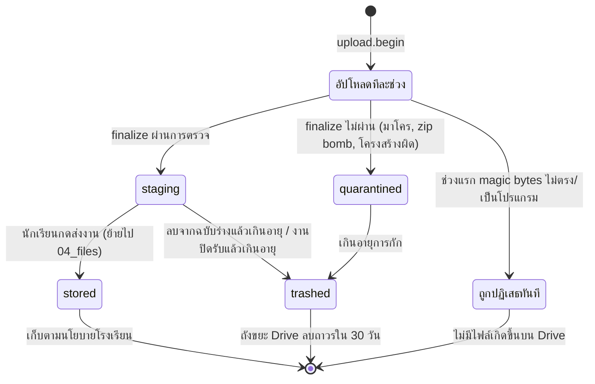
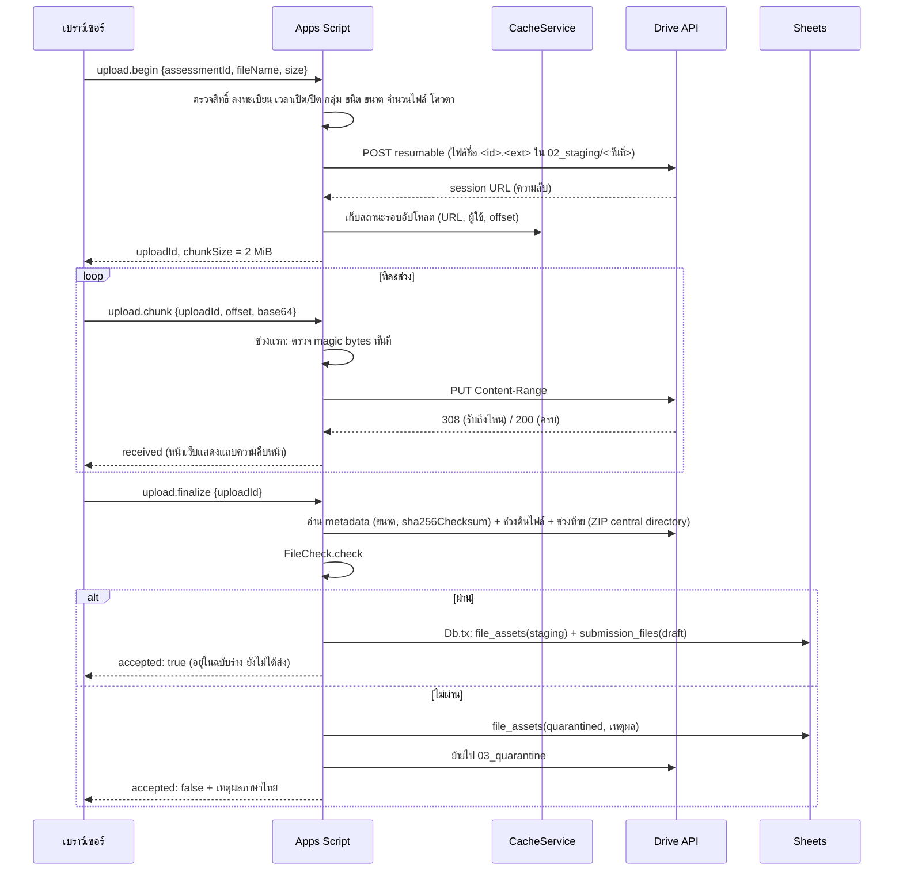

# การจัดเก็บไฟล์บน Google Drive

ตอบข้อกำหนดข้อ 9 (แฟ้มงานและการจัดเก็บไฟล์) และข้อ 16 (การคุ้มครองข้อมูล/สำรอง)

## 1. หลักการ

1. **ไฟล์จริงอยู่ใน Drive ของบัญชีระบบ ในโฟลเดอร์ที่ไม่แชร์ใคร** — ผู้ใช้ไม่ได้รับสิทธิ์บน Drive เลย เข้าถึงผ่านระบบเท่านั้น
2. **ตัวเชื่อมถาวรคือ `file_assets.drive_file_id`** — ย้ายโฟลเดอร์ เปลี่ยนชื่อ หรือเก็บรายวิชาถาวร ลิงก์หลักฐานไม่เสีย
3. **ชื่อไฟล์จริง = `<file_asset_id>.<นามสกุล>`** แยกจากชื่อที่นักเรียนตั้ง (เก็บใน `original_name` หลังกรองอักขระ)
4. **โฟลเดอร์ที่ผู้ใช้เห็นเป็นโฟลเดอร์เสมือน** สร้างจากฐานข้อมูล (รายบุคคล/รายกลุ่ม) ส่วนโครงสร้างจริงบน Drive มีไว้ให้ผู้ดูแลกู้คืนด้วยมือได้
5. **งานกลุ่มเก็บไฟล์ชุดเดียวต่อรุ่น** แล้วอ้างอิงไปยังสมาชิกทุกคนใน snapshot ไม่ทำสำเนาต่อคน
6. **อัปโหลดเสร็จ ≠ ส่งงาน** ไฟล์อยู่ในฉบับร่าง (staging) จนนักเรียนกดส่งและได้ใบยืนยัน

## 2. โครงสร้างโฟลเดอร์จริง

```text
CWK Learning Hub — ข้อมูลระบบ (ห้ามแชร์)/
├── 01_database/            ไฟล์ Google Sheets 6 ไฟล์ (core plan work files grades system)
├── 02_staging/
│   └── 2026-09-30/         ไฟล์ที่อัปโหลดแล้วแต่ยังไม่ส่ง แยกตามวันที่อัปโหลด
│       └── 3f2c…e1.pdf
├── 03_quarantine/          ไฟล์ที่ตรวจไม่ผ่าน (เก็บตามอายุที่ตั้ง แล้วทิ้ง)
├── 04_files/
│   └── 2569-1/                              ปีการศึกษา-ภาคเรียน
│       └── ว32201_ม.5_1_8f3a1c2d/            รหัสวิชา_กลุ่มเรียน_รหัสย่อรายวิชาที่เปิดสอน
│           └── W1_5b7e9a10/                  รหัสงาน_รหัสย่อ
│               └── 3f2c…e1.pdf               <file_asset_id>.<ext>
├── 05_result_snapshots/    ผลปิดรายวิชา (JSON + checksum) — ระยะถัดไป
├── 06_exports/             ไฟล์รายงานที่ส่งออก (มีวันหมดอายุ) — ระยะถัดไป
├── 07_imports/             ไฟล์นำเข้าต้นฉบับ — ระยะถัดไป
└── 08_backups/
    └── 2026-10-01_020015/  สำเนาไฟล์ Sheets ทั้ง 6 + manifest.json
```

รหัสโฟลเดอร์ทั้งหมดเก็บใน Script Properties (`FOLDER_ROOT`, `FOLDER_STAGING`, …) ไม่ค้นจากชื่อ

## 3. วงจรชีวิตไฟล์ (`file_assets.state`)



- ไฟล์ที่อัปโหลดไม่ครบ (เน็ตหลุด) ไม่กลายเป็นไฟล์บน Drive เพราะ resumable session ที่ไม่จบถูกทิ้งเอง
- `stored` คือไฟล์ที่อยู่ในรุ่นการส่งแล้ว ไม่ถูกงานล้างไฟล์แตะ
- ถ้าย้ายไฟล์จาก staging ไป 04_files ล้มเหลวตอนส่ง การส่งยังสำเร็จ (ฐานข้อมูลถูกต้อง) และงานรายชั่วโมงย้ายให้ภายหลัง

## 4. ขั้นตอนอัปโหลด



การทนต่อเน็ตหลุด:
- ส่งช่วงเดิมซ้ำ → ระบบรู้ว่ารับแล้ว (offset น้อยกว่าที่รับ) ตอบ `duplicate` ไม่เขียนซ้ำ
- ส่งข้ามช่วง → `UPLOAD_OUT_OF_ORDER` พร้อมตำแหน่งที่ต้องส่งต่อ
- คำขอไป Drive ล้มเหลว → ถามสถานะจริงจาก Drive (`Content-Range: bytes */total`) แล้วให้หน้าเว็บส่งต่อจากตำแหน่งที่ถูกต้อง
- เรียก `finalize` ซ้ำได้ผลเดิม ไม่สร้างแถวซ้ำ

## 5. การตรวจไฟล์ (อ้างอิง OWASP File Upload Cheat Sheet)

| การตรวจ | รายละเอียด |
| --- | --- |
| ชนิดที่อนุญาต | ผู้ดูแลกำหนดระดับโรงเรียน (ค่าเริ่มต้น pdf jpg jpeg png webp docx xlsx pptx txt) ครูเลือกชุดย่อยต่องาน |
| ขนาด | ≤ เพดานงาน ≤ เพดานโรงเรียน (ค่าเริ่มต้น 25 MB/ไฟล์, 10 ไฟล์/การส่ง) แจ้งก่อนอัปโหลดและตรวจซ้ำที่เซิร์ฟเวอร์ |
| ชื่อไฟล์ | ตัดเส้นทาง อักขระควบคุม อักขระกลับทิศ (RTL override) อักขระต้องห้าม จำกัดความยาว ต้องมีนามสกุล |
| ชนิดจริง | ตรวจ magic bytes: PDF, JPEG, PNG, WEBP, GIF, ZIP; ไม่เชื่อนามสกุลหรือ Content-Type |
| เอกสาร Office/ODF | อ่าน ZIP central directory (ไม่แตกไฟล์): ต้องมี `[Content_Types].xml` + `word/` `xl/` `ppt/` ตามชนิด; ODF ต้องมี `mimetype` |
| มาโคร | พบ `vbaProject.bin` → ปฏิเสธ; ไฟล์ Office รุ่นเก่า (OLE2: .doc .xls .ppt) ปฏิเสธและแนะนำให้บันทึกเป็นรูปแบบใหม่หรือ PDF |
| ZIP | ห้ามเข้ารหัส, ห้าม ZIP64, จำนวนรายการ ≤ 2,000, ขนาดหลังแตกรวม ≤ 200 MB, อัตราบีบอัดผิดปกติ (zip bomb), เส้นทาง `../` |
| โปรแกรม | EXE (MZ), ELF, Mach-O ปฏิเสธเสมอแม้เปลี่ยนนามสกุล |
| ข้อความ/โค้ด | ต้องไม่มีไบต์ NUL และอักขระควบคุมผิดปกติ เก็บเป็นเอกสารดาวน์โหลด (text/plain) ไม่เปิดหรือรันบนเซิร์ฟเวอร์ |
| Checksum | SHA-256 จาก Drive (`sha256Checksum`) หรือคำนวณเองทีละช่วงถ้าไม่มี + MD5 |

**ข้อจำกัดที่ต้องแจ้ง**: Apps Script ไม่มีการสแกนไวรัส การตรวจนี้เป็นการตรวจโครงสร้าง ถ้าต้องการสแกนมัลแวร์
ให้เชื่อมบริการภายนอกเพิ่มในขั้น finalize (สถานะ `check_status` รองรับไว้แล้ว)

## 6. การเปิดดูและดาวน์โหลด

1. `files.open` → ตรวจสิทธิ์ (`Authz.canReadFile`) ทุกครั้ง → ออกตั๋วสุ่มอายุ 10 นาที ผูกกับผู้ใช้และไฟล์ (เก็บใน CacheService)
2. `files.chunk` ทีละ 3 MB ด้วยตั๋ว → Apps Script อ่านช่วงไบต์จาก Drive (HTTP Range) → base64
3. หน้าเว็บประกอบเป็น Blob แสดงรูปใน ``, PDF ใน `<iframe>`, ข้อความด้วย `textContent`; อื่น ๆ ให้ดาวน์โหลดเท่านั้น

กติกาสิทธิ์อ่านไฟล์:
- ผู้อัปโหลดเห็นไฟล์ของตน (ยกเว้นไฟล์ที่ถูกกัก — เปิดได้เฉพาะผู้ดูแล)
- ครู/ผู้ดูแลที่มี `can_view` ในรายวิชาของงาน
- นักเรียนเจ้าของงานเดี่ยว; งานกลุ่ม: ฉบับร่างเห็นเฉพาะสมาชิกปัจจุบัน, รุ่นที่ส่งเห็นเฉพาะสมาชิกใน snapshot ของรุ่นนั้น
- ใช้ตั๋วของผู้อื่นไม่ได้ (`FORBIDDEN`), ตั๋วหมดอายุต้องเปิดใหม่

## 7. แฟ้มเสมือน

| มุมมอง | โครงสร้าง | API |
| --- | --- | --- |
| แฟ้มรายบุคคล | ปีการศึกษา / ภาคเรียน / รายวิชา (กลุ่มเรียน) / รหัส-ชื่อนักเรียน / งาน / รุ่นที่ส่ง / ไฟล์ | `student.folder` (ตนเอง), `files.studentFolder` (ครู) |
| แฟ้มงานกลุ่ม | ปีการศึกษา / ภาคเรียน / รายวิชา / งาน / กลุ่ม / รุ่นที่ส่ง / ไฟล์ | `files.groupFolder` |

แฟ้มรายบุคคลรวมรุ่นของงานกลุ่มที่นักเรียนอยู่ใน snapshot (ไฟล์เดียวกันกับที่สมาชิกคนอื่นเห็น) จึงค้นจากชื่อนักเรียนได้โดยไม่ทำสำเนา

## 8. อายุการเก็บ การล้างไฟล์ และโควตา

| ค่าตั้ง (หน้าผู้ดูแล) | ค่าเริ่มต้น | ความหมาย |
| --- | --- | --- |
| `staging_retention_hours` | 72 | ไฟล์ที่ลบออกจากฉบับร่าง หรือค้างในร่างของงานที่ปิดรับแล้ว เกินเวลานี้ถูกทิ้ง |
| `quarantine_retention_days` | 30 | อายุไฟล์ที่ถูกกัก |
| `backup_retention_days` | 30 | อายุชุดสำรองฐานข้อมูล |
| `quota_total_mb` | 0 (ไม่ตั้ง) | โควตารวมของไฟล์ในระบบ |
| `quota_warn_percent` | 80 | แจ้งเตือนผู้ดูแลเมื่อพื้นที่ Drive ของบัญชีระบบถึงระดับนี้ |

ก่อนอัปโหลดทุกไฟล์ระบบตรวจพื้นที่ Drive จริง (เผื่อ 2%) และโควตาที่ตั้ง ถ้าเกิน → `QUOTA_EXCEEDED`
หน้าผู้ดูแลแสดงพื้นที่ที่ใช้ แยกไฟล์ส่งแล้ว/ฉบับร่าง/ถูกกัก

## 9. การสำรองและกู้คืน

- รายวัน (02:00 น.) คัดลอกไฟล์ Sheets ทั้ง 6 ไปยัง `08_backups/<วันที่_เวลา>/` พร้อม `manifest.json` (รหัสไฟล์สำรอง รหัสโฟลเดอร์ รุ่นโครงสร้าง)
- ไฟล์งานไม่ถูกคัดลอกซ้ำ (จะใช้พื้นที่สองเท่า) — ฐานข้อมูลสำรองอ้างอิง `drive_file_id` เดิมซึ่งยังอยู่
  ไฟล์ที่ถูกลบยังกู้จากถังขยะ Drive ได้ 30 วัน; หากต้องการสำรองไฟล์งานแยก ให้ใช้เครื่องมือสำรองของ Google Workspace หรือ Google Takeout ของโฟลเดอร์ `04_files`
- ขั้นตอนกู้คืนและการทดสอบคืนค่าบนสภาพแวดล้อมแยก ดู [06-deployment.md](06-deployment.md#7-การกู้คืนข้อมูล)
