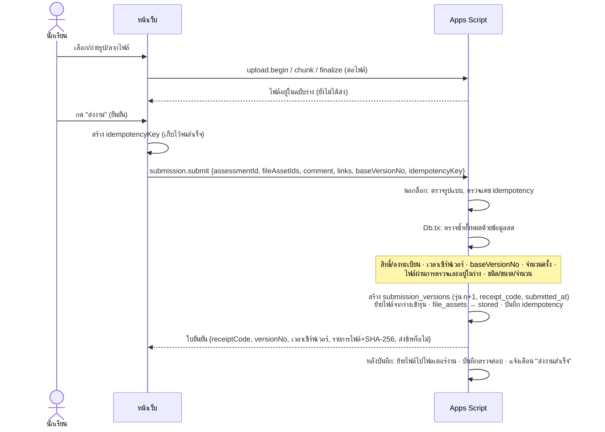
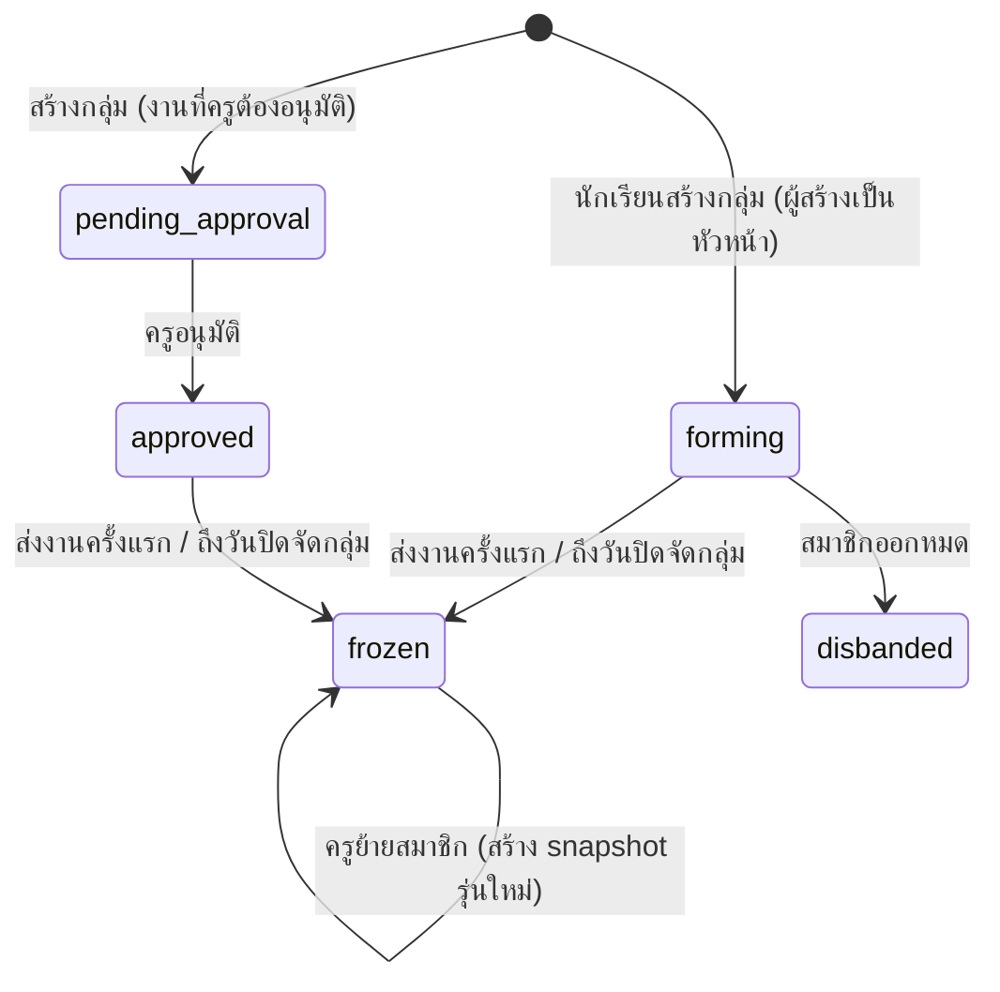

# ขั้นตอนการส่งงาน (งานเดี่ยวและงานกลุ่ม)

ตอบข้อกำหนดข้อ 7 (ภาระงานและการส่งงานเดี่ยว) และข้อ 8 (การจัดกลุ่มและการส่งงานกลุ่ม)

## 1. สถานะที่แยกกัน

ระบบแยก **สถานะการส่ง** (ตาราง `submissions`) **สถานะการตรวจของแต่ละรุ่น** (`submission_versions.review_status`)
และ **สถานะคะแนน/การประกาศ** (`student_grades`) ออกจากกัน จึงรองรับ "ส่งแล้วแต่ยังไม่ตรวจ" และ "ตรวจแล้วแต่ยังไม่ประกาศ" ได้ถูกต้อง

### สถานะที่นักเรียนเห็น (คำนวณจากทั้งสามส่วน)

| รหัส | ข้อความ | เงื่อนไข |
| --- | --- | --- |
| `not_open` | ยังไม่ถึงเวลา | ก่อน `open_at` |
| `not_submitted` | ยังไม่ส่ง (เลยกำหนด ถ้าเกิน `due_at`) | ยังไม่มีรุ่นที่ส่ง และไม่มีไฟล์ในร่าง |
| `draft` | ฉบับร่าง | มีไฟล์ในร่างแต่ยังไม่กดส่ง |
| `submitted` | ส่งแล้ว รอตรวจ | มีรุ่นที่ส่ง ตรงเวลา |
| `late` | ส่งช้า รอตรวจ | รุ่นล่าสุดส่งหลังกำหนดส่ง (ที่รวมการขยายเวลาแล้ว) |
| `returned` | ส่งคืนแก้ไข | ครูส่งคืนรุ่นล่าสุดพร้อมข้อความ |
| `resubmitted` | ส่งใหม่ รอพิจารณา | ส่งรุ่นใหม่หลังครูตรวจ/ส่งคืน (คะแนนและการตรวจรุ่นเดิมยังอยู่) |
| `accepted` | ตรวจแล้ว | ครูเลือกรุ่นนี้เพื่อประเมิน |
| `graded` | ประกาศคะแนนแล้ว | มีคะแนนที่ประกาศ (`published_at`) |
| `closed` | ปิดรับแล้ว (ไม่ได้ส่ง) | เลยเวลาปิดรับโดยไม่มีการส่ง |
| `score_only` | รับคะแนนอย่างเดียว | สอบ/รายการที่ไม่ต้องส่งไฟล์ |

หน้าเว็บแสดงสถานะเป็น **ข้อความ + สัญลักษณ์** ไม่ใช้สีอย่างเดียว

## 2. เวลาเปิด–กำหนดส่ง–ปิดรับ

- `open_at` ก่อนเวลานี้อัปโหลด/ส่งไม่ได้ (`SUBMISSION_NOT_OPEN`)
- `due_at` กำหนดส่ง ส่งหลังเวลานี้ = ส่งช้า (บันทึก `is_late`, `late_seconds`)
- `close_at` ปิดรับ
  - ถ้า `allow_late = true` รับถึง `close_at`
  - ถ้า `allow_late = false` ปิดที่ `due_at` (ค่าเริ่มต้น: ไม่รับงานช้า)
- **ขยายเวลา** รายบุคคลหรือรายกลุ่ม (`assessment_extensions`) พร้อมเหตุผล — ใช้แทนเวลาของงานสำหรับคนนั้น/กลุ่มนั้น
- ใช้ **เวลาเซิร์ฟเวอร์** เท่านั้น ไม่เชื่อเวลาจากเครื่องนักเรียน
- การหักคะแนนส่งช้า **ปิดเป็นค่าเริ่มต้น** (กฎเก็บใน `grading_policy_versions.late_penalty_json` — การคำนวณหักคะแนนอยู่ในระยะสมุดคะแนน)

## 3. การส่งงานเดี่ยว

กติกา:
- **ใบยืนยัน** มีรหัสการส่ง (`CWK-XXXX-XXXX`), เวลาเซิร์ฟเวอร์ (แสดงเวลาไทย ปี พ.ศ.), รายการไฟล์ — ถ้ายังไม่ได้ใบยืนยัน ถือว่ายังไม่ได้ส่ง
- **ส่งซ้ำ = รุ่นใหม่** รุ่นเดิม ผู้ส่ง เวลา ไฟล์ และผลตรวจของรุ่นเดิมยังเก็บครบ นักเรียนนำไฟล์จากรุ่นเดิมมาใส่ร่างได้โดยไม่ทำสำเนาไฟล์
- **จำนวนครั้ง** `max_attempts` (0 = ไม่จำกัด) — เมื่อครูส่งคืนแก้ไข นักเรียนส่งใหม่ได้แม้ครบจำนวนแล้ว
- **กดซ้ำ/เน็ตหลุด**: หน้าเว็บใช้ `idempotencyKey` เดิมจนสำเร็จ ส่งซ้ำได้ผลเดิม (`replayed: true`) ไม่สร้างรุ่นซ้ำ
- **อัปโหลดไม่ครบ**: ไฟล์ที่ยังไม่ `finalize` ผ่าน ไม่อยู่ในร่าง ส่งไม่ได้ และหน้าเว็บไม่แสดงว่าสำเร็จ
- **ลิงก์** แนบได้เมื่อครูอนุญาต ต้องขึ้นต้น http:// หรือ https:// ไม่เกิน 10 ลิงก์

## 4. การจัดกลุ่ม

- ครูกำหนดต่องาน: สมาชิกต่ำสุด/สูงสุด (เช่น 2 หรือ 3–4), วันปิดจัดกลุ่ม, ต้องอนุมัติหรือไม่, ให้ส่งแทนกลุ่มได้ทุกคน (ค่าเริ่มต้น) หรือหัวหน้าเท่านั้น
- นักเรียน: สร้างกลุ่ม · เชิญเพื่อน · ขอเข้าร่วม · ตอบรับ/ปฏิเสธ · ออกจากกลุ่ม — **ผู้ถูกเชิญต้องยืนยันเอง** ไม่มีการเพิ่มคนอื่นโดยพลการ
- **หนึ่งคนอยู่ได้หนึ่งกลุ่มต่องาน** และต้องลงทะเบียนในรายวิชานั้น; เมื่อเข้ากลุ่มหนึ่ง คำเชิญ/คำขออื่นของงานเดียวกันถูกยกเลิก
- **ที่ว่างสุดท้าย**: ตรวจจำนวนสมาชิกจากแถวจริงภายใต้ล็อก ถ้าสองคนตอบรับพร้อมกัน สำเร็จคนเดียว อีกคนได้ `GROUP_FULL`
- **กลุ่มไม่ครบ/นักเรียนเหลือ**: หน้าครูแสดงกลุ่มที่จำนวนไม่ตรงและรายชื่อนักเรียนที่ยังไม่มีกลุ่ม ครูจัดเข้ากลุ่ม
  หรืออนุมัติข้อยกเว้นจำนวนพร้อมเหตุผล ระบบไม่ปรับขนาดกลุ่มเองหรือทิ้งนักเรียน — กลุ่มที่จำนวนไม่ตรงและไม่มีข้อยกเว้นส่งงานไม่ได้ (`GROUP_SIZE_INVALID`)
- **ตรึงรายชื่อ (snapshot)** เมื่อส่งงานครั้งแรกหรือถึงวันปิดจัดกลุ่ม แล้วแต่อย่างใดเกิดก่อน
  (การตรึงตามเวลาทำทั้งแบบทันทีเมื่อมีคนใช้งานหลังเวลาปิด และงานรายชั่วโมง)
- **หลังตรึง** มีเพียงครูที่ย้ายสมาชิกได้: ระบบแสดงผลกระทบก่อน (จำนวนรุ่นที่ส่ง มีคะแนนกลุ่มหรือยัง) ต้องยืนยันพร้อมเหตุผล
  แล้วสร้าง snapshot รุ่นใหม่ — **รุ่นการส่งเดิมยังชี้ snapshot เดิม** คะแนนเดิมไม่ถูกย้ายอัตโนมัติ มีประวัติทุกขั้น
- ครูคัดลอกกลุ่มจากงานก่อนเป็นกลุ่มของงานใหม่ได้ การเปลี่ยนสมาชิกงานใหม่ไม่ย้อนไปแก้งานเก่า

## 5. การส่งงานกลุ่ม

- สมาชิกทุกคนเห็นและอัปโหลดเข้า **ฉบับร่างเดียวกันของกลุ่ม**
- ส่งแทนกลุ่มได้ตามนโยบาย ระบบบันทึกชื่อผู้ส่ง และ snapshot ณ เวลาส่ง (`member_snapshot_no`)
- **ป้องกันส่งทับกัน**: ทุกการส่งแนบ `baseVersionNo` (รุ่นล่าสุดที่ผู้ส่งเห็น)
  ถ้าเพื่อนส่งรุ่นใหม่ไปก่อน → `CONFLICT` "มีการส่งรุ่นที่ n แล้ว โดย … เวลา … กรุณาตรวจสอบก่อนส่งรุ่นใหม่"
- ไฟล์จริงเก็บชุดเดียวต่อรุ่น และปรากฏในแฟ้มของสมาชิกทุกคนใน snapshot
- ทุกคนใน snapshot ได้รับแจ้งเตือน "ส่งงานสำเร็จ" พร้อมรหัสยืนยัน

## 6. การตรวจของครู (ส่วนที่เกี่ยวกับการส่งงาน)

- **คิวตรวจงาน**: รายคนหรือรายกลุ่ม สถานะ รุ่น เวลาส่งล่าสุด กรองรอตรวจ/ส่งช้า/ยังไม่ส่ง; นับจาก **จำนวนคน/กลุ่ม ไม่ใช่จำนวนไฟล์**
- **รายละเอียด**: ทุกรุ่น ผู้ส่ง สมาชิก ณ เวลาส่ง ไฟล์ (เปิดดูรูป/PDF ในหน้า) คำอธิบาย ลิงก์
- **รับรุ่นนี้เพื่อประเมิน** (`accepted_version_id`) หรือ **ส่งคืนแก้ไข** พร้อมข้อความ (ต้องระบุ) → นักเรียนได้รับแจ้งเตือนโดยไม่มีคะแนนในข้อความ
- การให้คะแนน กระจายคะแนนกลุ่ม ปรับรายคน และประกาศคะแนน อยู่ในระยะสมุดคะแนน (ตารางรองรับไว้แล้ว: `group_grades`, `student_grades`, `grade_revisions`, `grade_publications`)

## 7. แจ้งเตือนในระบบ

| เหตุการณ์ | ผู้รับ |
| --- | --- |
| ส่งงานสำเร็จ (รุ่น + รหัสยืนยัน) | ผู้ส่ง หรือสมาชิกทุกคนใน snapshot |
| ได้รับคำเชิญเข้ากลุ่ม | ผู้ถูกเชิญ |
| งานถูกส่งคืนแก้ไข | นักเรียน/สมาชิกกลุ่ม |
| พื้นที่ Drive ใกล้เต็ม | ผู้ดูแล |

ข้อความแจ้งเตือนไม่มีคะแนนส่วนตัว การส่งผ่านอีเมลหรือ LINE เป็นส่วนต่อขยายภายหลัง
