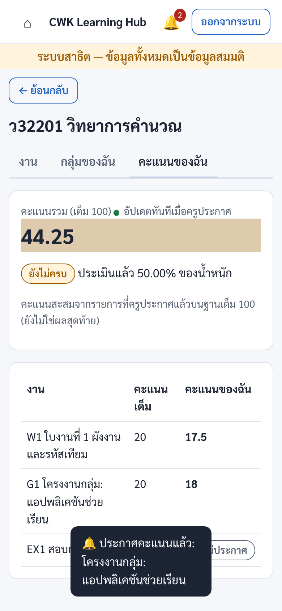
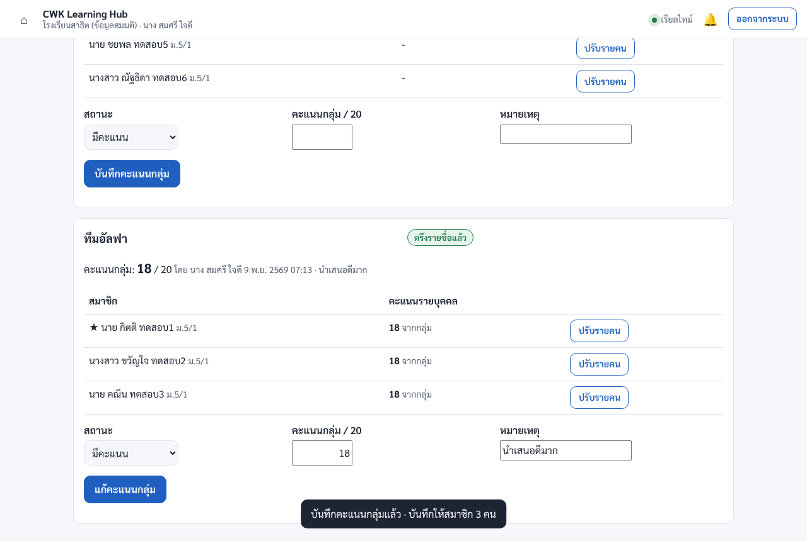
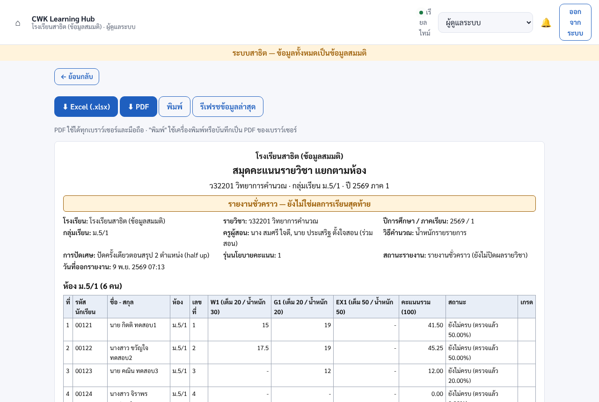

# CWK Learning Hub — รุ่นแอปมือถือ (Firebase · เรียลไทม์)

แอปเดียวติดตั้งได้ทั้ง **iOS, Android และมือถือ/แท็บเล็ตอื่น ๆ** ใช้ **Firebase** เป็นฐานข้อมูล
ทุกหน้าจออัปเดต **แบบเรียลไทม์** — ครูกดประกาศคะแนน หน้าจอนักเรียนเปลี่ยนทันทีโดยไม่ต้องรีเฟรช

> สถานะ: ทดสอบครบวงจรบน Firebase Emulator แล้ว (ฟังก์ชันฝั่งเซิร์ฟเวอร์ 21 กรณี + ทดสอบแอปจริงในเบราว์เซอร์ 19 ขั้นตอน)
> **ยังไม่ได้ deploy บนโปรเจกต์ Firebase จริง และยังไม่ได้ build เป็นไฟล์ APK/IPA** (ต้องใช้ Android Studio / Xcode บนเครื่องของผู้พัฒนา ดูหัวข้อ "ติดตั้งบนมือถือ")

| นักเรียน (มือถือ) | ครู: ให้คะแนนกลุ่ม | รายงาน PDF |
| --- | --- | --- |
|  |  |  |

## ติดตั้งได้ 3 แบบจากโค้ดชุดเดียว

| แบบ | ใช้กับ | วิธีได้แอป |
| --- | --- | --- |
| **PWA** (เว็บแอปติดตั้งได้) | iPhone/iPad (Safari), Android (Chrome), Huawei/HarmonyOS, แท็บเล็ต, คอมพิวเตอร์ — ทุกเครื่องที่มีเบราว์เซอร์รุ่นใหม่ | เปิดเว็บ → "เพิ่มไปยังหน้าจอโฮม" / "ติดตั้งแอป" (ไม่ต้องผ่าน App Store) |
| **แอป Android** (Capacitor) | Google Play หรือแจกไฟล์ APK/AAB | `npm run cap:android` → Android Studio → Build |
| **แอป iOS** (Capacitor) | App Store / TestFlight | `npm run cap:ios` → Xcode (ต้องใช้ Mac + Apple Developer) |

ทั้งสามแบบใช้หน้าจอและข้อมูลชุดเดียวกัน (โฟลเดอร์ `app/`) — ฟอนต์ไทยฝังในแอป เปิดดูข้อมูลล่าสุดได้แม้ออฟไลน์ และซิงก์เองเมื่อกลับมาออนไลน์

## อะไรอัปเดตแบบเรียลไทม์บ้าง

ใช้ Firestore `onSnapshot` ทุกหน้า (ไม่มีปุ่มรีเฟรช) — วัดจากการทดสอบบน Emulator: หน้าจออีกเครื่องเปลี่ยนภายใน ~0.1–0.3 วินาทีหลังบันทึก (ครั้งแรกหลังเปิดเซิร์ฟเวอร์ ~2 วินาที เพราะ Cloud Function เพิ่งเริ่มทำงาน)

| เมื่อ… | หน้าจอที่เปลี่ยนทันที |
| --- | --- |
| ครูประกาศคะแนน (งานเดี่ยวหรืองานกลุ่ม) | "คะแนนของฉัน" ของนักเรียน + คะแนนรวม + แจ้งเตือน 🔔 |
| ครูให้คะแนนกลุ่ม | คะแนนรายบุคคลของสมาชิกทุกคนในหน้าครู, สมุดคะแนนของครูทุกคนในรายวิชา |
| ครูคนหนึ่งบันทึกคะแนน | หน้าให้คะแนนของครูร่วมสอนที่เปิดอยู่ (ช่องที่กำลังพิมพ์ไม่ถูกเขียนทับ มีแจ้งว่ามีผู้อื่นแก้) |
| นักเรียนกดส่งงาน | คิวตรวจงานของครู, จำนวนผู้ส่ง/ส่งช้า |
| ครูรับงาน/ส่งคืนแก้ไข | สถานะงานบนมือถือนักเรียน + แจ้งเตือน |
| ครู/หัวหน้ากลุ่มเพิ่มสมาชิก, ส่งคำเชิญ, ตอบรับ | หน้า "กลุ่มของฉัน" ของทุกคนที่เกี่ยวข้อง และหน้ากลุ่มของครู |
| ผู้ดูแลเพิ่ม/นำเข้านักเรียน, อนุมัติคำขอสมัคร | รายชื่อนักเรียน/คำขอบนหน้าจอผู้ดูแลทุกคน |
| ผู้ดูแลให้/ถอนบทบาท หรือปิดบัญชี | ผู้ใช้คนนั้นได้สิทธิ์ใหม่ทันที (ขอโทเคนใหม่อัตโนมัติ) หรือถูกออกจากระบบ |
| ผู้ดูแลแก้ตั้งค่า (ชนิด/ขนาดไฟล์) | หน้าส่งงานของนักเรียนทุกคน |

## สถาปัตยกรรม

```text
 แอป (PWA / iOS / Android)  ── app/  (Vite + Firebase JS SDK, ไม่มีเฟรมเวิร์ก)
   │  อ่าน: Firestore onSnapshot (เรียลไทม์ + แคชออฟไลน์) ── ตรวจสิทธิ์ด้วย firestore.rules
   │  เขียน: httpsCallable('api', { action, payload }) ── Cloud Function เดียว (asia-southeast1)
   │  อัปโหลด: Cloud Storage uploads/{uid}/… (resumable) → ฟังก์ชันตรวจชนิดไฟล์จริง แล้วย้ายเข้าที่เก็บงาน
   ▼
 Firebase
   Authentication  ชื่อผู้ใช้/รหัสนักเรียน + รหัสผ่าน (ไม่ต้องมีอีเมล) · custom claims { schoolId, roles }
   Firestore       ข้อมูลทั้งหมด (โครงสร้างใน functions/src/lib/*.js ส่วนหัวของแต่ละไฟล์)
   Cloud Functions ตรรกะธุรกิจทั้งหมด (transaction, ตรวจสิทธิ์, ประวัติ, คะแนนกลุ่ม → สมาชิก)
   Cloud Storage   ไฟล์งาน (ไม่มีลิงก์สาธารณะ เปิดไฟล์ผ่านฟังก์ชันที่ตรวจสิทธิ์ทุกครั้ง)
```

- **การเขียนทั้งหมดผ่าน Cloud Functions** (แอปเขียน Firestore ตรงได้เพียง "อ่านแจ้งเตือนแล้ว") — กฎธุรกิจอยู่ที่เซิร์ฟเวอร์ที่เดียว
- **คะแนนกลุ่มอยู่ที่กลุ่ม**: `offerings/{id}/groupGrades/{งาน}_{กลุ่ม}` และคัดลอกเป็นคะแนนรายบุคคล `grades/{งาน}_{นักเรียน}` ของสมาชิกทุกคนใน transaction เดียว (ไม่หารจำนวนสมาชิก) กลุ่มเดิมทำได้หลายงาน คะแนนแต่ละงานแยกกัน
- **นักเรียนเห็นเฉพาะค่าที่ประกาศ** (`published/{นักเรียน}`) ไม่เห็นคะแนนร่างหรือคะแนนของเพื่อน — บังคับด้วย Security Rules
- โมดูลคำนวณคะแนน/Excel ใช้ร่วมกันระหว่างเซิร์ฟเวอร์และแอป (`functions/src/shared/` สร้างจาก `gas/*.js` ด้วย `npm run shared`) หน้าจอ, PDF, Excel และคะแนนที่นักเรียนเห็นจึงตรงกัน

## โครงสร้างโฟลเดอร์

```text
firebase/
  app/                    แอป (PWA + เว็บที่ Capacitor ห่อเป็น iOS/Android)
    index.html            โครงหน้า + manifest
    src/main.js           เริ่มแอป เลือกหน้าแรกตามบทบาท แจ้งเตือนเรียลไทม์ ปุ่มย้อนกลับ Android
    src/lib/              fb.js (เชื่อม Firebase), router.js, ui.js, session.js, files.js, save.js, gradebook.js
    src/views/            common (เข้าระบบ/สมัคร), student, teacher, grading, admin, reports
    public/               manifest.webmanifest, icons/
    sw-template.js        service worker (สร้างรายการไฟล์ตอน build)
  functions/              Cloud Functions (Node.js 22) — src/index.js รวมทุก action
  android/  ios/          โปรเจกต์แอปเนทีฟ (สร้างโดย Capacitor — เปิดด้วย Android Studio / Xcode)
  resources/              ไอคอน/หน้าเปิดแอป ต้นฉบับ (npm run icons → npm run cap:assets)
  firestore.rules  storage.rules  firestore.indexes.json  firebase.json  capacitor.config.json
  scripts/                seed (ข้อมูลสาธิต), bootstrap (ติดตั้งครั้งแรก), dev-demo
  tests/                  ทดสอบฟังก์ชัน + Security Rules กับ Emulator (21 กรณี)
  tests-e2e/              ทดสอบแอปจริงในเบราว์เซอร์หลายเครื่องพร้อมกัน (19 ขั้นตอน)
```

## ทดลองบนเครื่อง (ไม่ต้องมีโปรเจกต์ Firebase)

ต้องมี Node.js 22 และ Java 21 (สำหรับ Firestore Emulator)

```bash
cd firebase
npm install && (cd functions && npm install)
npm run dev:demo        # เปิด Emulator + ใส่ข้อมูลสาธิต + แอปที่ http://127.0.0.1:5173
```

บัญชีสาธิต (รหัสผ่าน `Demo#Pass2569` ทุกบัญชี · รหัสโรงเรียน `DEMO` · ใช้ได้กับ Emulator เท่านั้น)

| บัญชี | บทบาท |
| --- | --- |
| `demo_admin` | ผู้ดูแลระบบ + ผู้ดูแลคะแนน |
| `demo_t001` | ครูเจ้าของรายวิชา ว32201 ม.5/1 (มีงานเดี่ยว W1 งานกลุ่ม G1 สอบ EX1) |
| `demo_t002` | ครูเจ้าของ ว32281 และครูร่วมสอน ว32201 (ให้คะแนน/ส่งออกได้) |
| `00121`–`00132` | นักเรียน (00121–00123 = ทีมอัลฟา, 00124–00126 = ทีมเบต้า, 00127–00128 ยังไม่มีกลุ่ม) |

ลองเปิด 2 หน้าต่าง (หรือมือถือ + คอมพิวเตอร์) เป็นครูและนักเรียน แล้วให้คะแนน/ประกาศ จะเห็นหน้าจอนักเรียนเปลี่ยนทันที
ทดสอบบนมือถือในวง LAN: ตั้ง `host` ของ emulators ใน `firebase.json` เป็น `0.0.0.0` แล้วรัน `VITE_EMULATOR_HOST=<IP เครื่อง> npm run dev:demo -- --host 0.0.0.0`

## ทดสอบ

```bash
npm test             # Cloud Functions + Security Rules บน Emulator (21 กรณี: สิทธิ์, transaction พร้อมกัน, คะแนนกลุ่ม, ส่งงาน, ไฟล์)
npm run test:e2e     # แอปจริงใน Chromium: ครู 2 + นักเรียนบนมือถือ 3 + ผู้ดูแล — ตรวจการอัปเดตเรียลไทม์ข้ามเครื่อง, ส่งงาน, คะแนนกลุ่ม, PDF/Excel
```

ผลล่าสุด: `npm test` ผ่าน 21/21 · `npm run test:e2e` ผ่าน 19/19 ขั้นตอน (ภาพหน้าจอใน [docs/screenshots](../docs/screenshots))

## ติดตั้งใช้งานจริงบน Firebase

> **คู่มือละเอียดทีละขั้นตอน (พร้อมเมนูใน Console, คำสั่ง Windows/macOS, การสร้างแอป Android/iOS และการแก้ปัญหา): [docs/09-firebase-setup.md](../docs/09-firebase-setup.md)** — ด้านล่างเป็นสรุปย่อ

1. **สร้างโปรเจกต์** ที่ <https://console.firebase.google.com> แล้วเปลี่ยนเป็นแพ็กเกจ **Blaze** (จ่ายตามใช้ — Cloud Functions และ Cloud Storage ต้องใช้ Blaze; โรงเรียนขนาดกลางส่วนใหญ่อยู่ในโควตาฟรีรายเดือน แต่ต้องผูกบัตร ควรตั้ง Budget alert)
2. เปิดบริการ: **Authentication** → Sign-in method → Email/Password · **Firestore** (โหมด production, ตำแหน่ง `asia-southeast1`) · **Storage** (ตำแหน่งเดียวกัน)
3. Project settings → Your apps → เพิ่ม **Web app** → คัดลอกค่า config ใส่ `app/.env.local` (ดูตัวอย่าง `app/.env.example`; ค่าเหล่านี้ไม่ใช่ความลับ)
4. ผูกโปรเจกต์และ deploy

   ```bash
   cd firebase
   npx firebase login
   npx firebase use --add            # เลือกโปรเจกต์ (สร้าง .firebaserc — ไม่ commit)
   npm run deploy                    # build แอป + deploy rules, indexes, functions, storage, hosting
   ```

5. **สร้างโรงเรียนและผู้ดูแลคนแรก** (ใช้ service account ที่ดาวน์โหลดจาก Project settings → Service accounts — ห้าม commit)

   ```bash
   GOOGLE_APPLICATION_CREDENTIALS=service-account.json GCLOUD_PROJECT=<project-id> \
     node scripts/bootstrap.mjs --code CWK --name "โรงเรียนจุนวิทยาคม" --admin admin
   ```

   ระบบพิมพ์รหัสผ่านชั่วคราวครั้งเดียว ผู้ดูแลต้องตั้งรหัสใหม่เมื่อเข้าใช้ครั้งแรก
6. เปิด `https://<project-id>.web.app` → เข้าระบบ → เพิ่มปีการศึกษา ครู นักเรียน (นำเข้าจาก Excel ได้) → แจก URL ให้ครูและนักเรียน

## ติดตั้งบนมือถือ

**PWA (เร็วที่สุด ไม่ต้องผ่านร้านแอป)**
- iPhone/iPad: เปิด URL ใน Safari → ปุ่มแชร์ → "เพิ่มไปยังหน้าจอโฮม"
- Android/HarmonyOS: เปิดใน Chrome/เบราว์เซอร์ → แถบ "ติดตั้งแอป" ด้านบนของแอป หรือเมนู ⋮ → "ติดตั้งแอป"

**แอป Android (Google Play หรือไฟล์ APK)** — ต้องมี Android Studio
```bash
npm run cap:android      # build เว็บ → คัดลอกเข้า android/ → เปิด Android Studio
```
Android Studio → Build → Generate Signed App Bundle / APK (เก็บไฟล์ keystore ไว้อย่างดี ใช้ทุกครั้งที่อัปเดต)

**แอป iOS (App Store / TestFlight)** — ต้องมี Mac + Xcode + บัญชี Apple Developer
```bash
npm run cap:ios          # build เว็บ → คัดลอกเข้า ios/ → เปิด Xcode
```
Xcode → เลือก Team (Signing & Capabilities) → Product → Archive → Distribute (TestFlight/App Store)

ก่อนส่งร้านแอป: เปลี่ยน `appId` ใน `capacitor.config.json` (ตอนนี้ `th.cwk.learninghub`) ให้ตรงกับโดเมนของโรงเรียน แล้วรัน `npx cap sync`
เปลี่ยนไอคอน: แก้ `app/public/icons/icon.svg` → `npm run icons` → `npm run cap:assets`
ทุกครั้งที่แก้หน้าจอ: `npm run cap:sync` แล้ว build ใหม่ใน Android Studio/Xcode (ข้อมูลไม่ต้องอัปเดตแอป เพราะอยู่บน Firebase)

สิ่งที่ทำไว้ให้แอปเนทีฟแล้ว: ปุ่มย้อนกลับของ Android ย้อนหน้าในแอป, ขอบจอ notch/แถบระบบ (safe area), ถ่ายภาพงานด้วยกล้อง (iOS มีข้อความขอสิทธิ์ภาษาไทย),
บันทึก/แชร์ไฟล์รายงาน PDF/Excel และไฟล์งานผ่านหน้าแชร์ของระบบ (WebView ดาวน์โหลดเองไม่ได้), ฟอนต์ไทยในแอป, เปิดได้ออฟไลน์

## ความปลอดภัย

- Security Rules ปฏิเสธทุกอย่างเป็นค่าเริ่มต้น อ่านได้ตามบทบาท (custom claims) + ความสัมพันธ์กับรายวิชา (`staff/{uid}`, `enrollments/{รหัส}`)
- นักเรียนเห็น: รายวิชาที่ลงทะเบียน, งานที่ประกาศ, กลุ่ม/การส่งงานของตน, คะแนนที่ประกาศของตนเท่านั้น; เพื่อนเห็นกันเพียงชื่อและห้อง
- ทุกการเขียนตรวจสิทธิ์ซ้ำที่ Cloud Function, ใช้ transaction (อ่านครบก่อนเขียน) และเลขรุ่นกันบันทึกทับ, บันทึกประวัติคะแนนทุกครั้ง และ audit log
- ไฟล์: อัปโหลดได้เฉพาะโฟลเดอร์ของตน ฟังก์ชันตรวจชนิดไฟล์จากเนื้อไฟล์จริง (ไม่เชื่อนามสกุล) คำนวณ SHA-256 ย้ายเข้าที่เก็บที่ไม่มีใครอ่านตรงได้ เปิดไฟล์ผ่านฟังก์ชันที่ตรวจสิทธิ์ทุกครั้ง ไฟล์ค้างใน uploads/ ลบอัตโนมัติทุกวัน
- รหัสผ่านชั่วคราวแสดงครั้งเดียว บังคับเปลี่ยน, เปลี่ยนรหัสต้องยืนยันรหัสเดิม และเพิกถอน session เดิม
- แนะนำเพิ่มเมื่อใช้งานจริง: เปิด **App Check** (reCAPTCHA Enterprise สำหรับเว็บ, Play Integrity / App Attest สำหรับแอป) และตั้ง Budget alert

## ค่าใช้จ่ายและขีดจำกัดที่ควรรู้

- Firestore คิดตามจำนวนการอ่าน: ตัวฟังเรียลไทม์อ่านเอกสารทั้งชุดครั้งแรก แล้วอ่านเฉพาะที่เปลี่ยน — หน้าสมุดคะแนนรายวิชา 40 คน × 20 งาน ≈ 800 การอ่านต่อการเปิดหนึ่งครั้ง (โควตาฟรี 50,000 การอ่าน/วัน)
- หน้า "นักเรียน" ของผู้ดูแลฟังรายชื่อนักเรียนทั้งโรงเรียนแบบเรียลไทม์ — เหมาะกับหลักพันคน ถ้าใหญ่กว่านั้นควรเปลี่ยนเป็นค้นหาทีละห้อง
- รายงาน PDF สร้างในเครื่องผู้ใช้ (แปลงหน้ารายงานเป็นภาพความละเอียดสูง) ไฟล์ใหญ่กว่า PDF แบบข้อความ — ค้นหาข้อความใน PDF ไม่ได้ ใช้ไฟล์ Excel เมื่อต้องการข้อมูลไปประมวลผลต่อ
- แจ้งเตือนเป็นแบบในแอป (เรียลไทม์ขณะเปิดแอป) ยังไม่มี push notification เมื่อปิดแอป (เพิ่มได้ด้วย Firebase Cloud Messaging)

## ยังไม่ได้ทำ / ข้อจำกัดที่ทราบ

- ยังไม่ได้ deploy บนโปรเจกต์ Firebase จริง และยังไม่ได้ build APK/IPA (สภาพแวดล้อมที่พัฒนาดาวน์โหลด Android SDK ไม่ได้ และไม่มี Xcode) — โปรเจกต์ `android/` และ `ios/` สร้างและซิงก์แล้ว พร้อมเปิดใน Android Studio/Xcode
- วิธีคำนวณแบบ "น้ำหนักรายหมวด" มีในตัวคำนวณ แต่ยังไม่มีหน้าตั้งค่าหมวด (ใช้แบบน้ำหนักรายรายการ)
- ยังไม่มีปิดผลรายวิชา/นำเข้าคะแนนจากไฟล์/push notification (เหมือนรุ่น Apps Script)
- Storage Emulator ในสภาพแวดล้อมทดสอบนี้ใช้กฎข้ามบริการ (`firestore.get()` ใน storage.rules) ไม่ได้ จึงออกแบบให้การเปิดไฟล์ผ่าน Cloud Function แทน (ปลอดภัยกว่าเดิม: ไม่มีใครอ่านไฟล์งานจาก Storage ตรง ๆ ได้)
